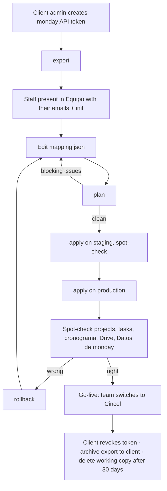

# monday.com migration: runbook per client

One pass of this runbook moves one client's monday account into Cincel. It
follows the flowchart in `docs/specs/monday-migration/backend.md` §9 and the
running rules in §2.1. Every step can be repeated, and everything up to
go-live can be undone with `rollback`.



In the commands below `acme` stands for the client's folder name under
`exports/`, `<prod-host>` for the production server's SSH host and
`oscar@cincel.mx` for the staff email that runs the import. Replace them.

---

## 0. Before the first client

Do these once, not per client.

- **Where it runs.** From a checkout of this repo on the operator's machine,
  never inside the production image (it has no `scripts/` and no `tsx`).
  Check out the release that production runs, so the CLI and the database
  have the same schema:

  ```bash
  cd cincel-workspace
  git fetch --tags
  git checkout cincel-app-vX.Y.Z      # the IMAGE_TAG production runs
  cd cincel-app
  npm ci
  ```

- **Disk.** `exports/` holds client PII and files. Keep the checkout on an
  encrypted disk. `exports/` and every `.env*` file are git-ignored and
  docker-ignored; never move them elsewhere in the repo.

- **Google.** The service account (`GOOGLE_SA_CLIENT_EMAIL` /
  `GOOGLE_SA_PRIVATE_KEY`) must be a **Content manager** on:
  - the company Shared Drive (production, `GOOGLE_SHARED_DRIVE_ID`), see
    `docs/google-drive.md` → "Shared Drive for project folders";
  - a second, empty Shared Drive used only for staging runs (for example
    _Cincel — Migración staging_), so staging folders never land next to the
    real project folders.

- **Phase 4 first.** Don't run a real client's staging spot-check until
  monday Migration Phase 4 (child tasks, dependencies, Datos de monday,
  project Bitácora) is on the release you checked out. Without it, part of
  what was imported can't be seen, so it can't be checked.

- **Env files.** Two git-ignored files in `cincel-app/`, one per target. Only
  `MONDAY_TOKEN` is read by the CLI itself; the rest is loaded into the shell
  with `set -a` before each command group (§2).

  `.env.monday.staging`:

  ```bash
  DATABASE_URL=postgres://cincel:<staging password>@127.0.0.1:15433/cincel
  GOOGLE_SA_CLIENT_EMAIL=<service account email>
  GOOGLE_SA_PRIVATE_KEY="<PEM key, literal \n allowed>"
  GOOGLE_SHARED_DRIVE_ID=<staging Shared Drive id>
  ```

  `.env.monday.prod`:

  ```bash
  DATABASE_URL=postgres://cincel:<prod password>@127.0.0.1:15432/cincel
  GOOGLE_SA_CLIENT_EMAIL=<service account email>
  GOOGLE_SA_PRIVATE_KEY="<PEM key, literal \n allowed>"
  GOOGLE_SHARED_DRIVE_ID=<company Shared Drive id>
  ```

  Never put real values in this runbook, a commit, an issue or a chat. The
  prod password is `POSTGRES_PASSWORD` from the server's compose environment.

---

## 1. Client admin creates the monday API token

The token sees only what its user sees, so it has to come from a monday
**admin** of the client's account.

1. Ask the client's monday admin to open their avatar → **Developers** →
   **My access tokens** → **Show** and copy the personal API token.
2. Receive it over a channel that doesn't keep it (a call, or a password
   manager share). Not email, not chat.
3. Put it in the git-ignored `cincel-app/.env.monday`:

   ```bash
   MONDAY_TOKEN=<token>
   ```

   Or leave the file out and type the token when the CLI asks (input is
   hidden). Never pass it as a flag or as `MONDAY_TOKEN=… npm run …`: that
   keeps it in shell history, and the CLI refuses `--token`.

4. Write down who created the token and when; step 9 needs it.

## 2. export

No database or Drive needed. Run it from `cincel-app/`:

```bash
npm run monday -- export --out exports/acme
```

- It prints the account, the token user, the boards visible to the token and
  an estimate of monday API calls, then asks `Start the export? [y/N]`.
  Check the board count with the client before answering `y`: a missing board
  means the token's user can't see it.
- Daily limits are 1,000 calls (Free/Basic/Standard), 10,000 (Pro), 25,000
  (Enterprise), reset at 00:00 UTC. If the estimate is close to the limit,
  export in parts with `--boards 123,456`.
- Options: `--boards 123,456` (only those boards), `--no-files`,
  `--no-updates`.
- **Resumable.** If it stops (limit reached, network), run the same command
  again. Boards with a `.done` marker are skipped.
- Files are downloaded during the export (monday's file links last 1 hour);
  they can't be fetched later.
- Done when it prints `Export finished: N/N boards in exports/acme`. Check
  `exports/acme/manifest.json` → `errors[]` for failed pages or files.

## 3. Staff in Equipo, then init

`init` matches monday people to Cincel staff by lower-case email, so every
staff member who appears in monday must exist first.

1. Open `exports/acme/users.json` and list the people with a
   `kind` of member or admin.
2. In Cincel production, **Equipo**: make sure each one exists, is active and
   has the same email as in monday. Add or fix them there.
3. Draft the mapping. `init` reads the export and the Cincel database (no
   monday calls), so it needs the staging tunnel (§5.1) or the production
   tunnel (§6.1) open, read-only use:

   ```bash
   set -a; . ./.env.monday.staging; set +a
   npm run monday -- init --export exports/acme
   ```

   It prints, per board, the strategy, the client and whether a cronograma is
   on, plus `people: N staff, N guests as contacts, N unmatched`, and writes
   `exports/acme/mapping.json`. It refuses to overwrite an edited mapping;
   `--force` drafts it again from scratch.

   Run `init` and `plan` against the same database you will apply to. A
   staging copy taken today matches production; if staging is older, rerun
   `plan` against production before applying there (§6.2).

## 4. Edit mapping.json, then plan until clean

Schema: `docs/specs/monday-migration/backend.md` §5.4. Typical edits:

- `boards[].strategy`: `board_as_project`, `group_as_project`,
  `item_as_project`, `crm_contacts` or `skip`.
- `boards[].client` (or `groupClients`): `{ "kind": "contact", "contactId" }`,
  `{ "kind": "relation_column", "columnId" }` or
  `{ "kind": "new", "name", "contactKind" }`.
- `statusMaps`: a target for every label id in use.
- `people`: `{ "action": "staff", "staffId" }`, `{ "action": "contact" }`,
  `{ "action": "ignore" }`.
- `subitems`: `checklist`, `child_tasks` or `ignore`; `schedule.enabled` and
  `schedule.planta` for the cronograma; `projectNames` / `projectCodes` /
  `contactMatches` to fix name and code collisions.

Then:

```bash
set -a; . ./.env.monday.staging; set +a
npm run monday -- plan --export exports/acme
```

`plan` writes only `exports/acme/plan.md` and prints the counts and the
issues. It exits 1 while any blocking issue is left. Blocking codes and the
fix for each are in backend §6 (`CLIENT_UNRESOLVED`, `CONTACT_NAME_TAKEN`,
`PROJECT_NAME_TAKEN`, `PROJECT_CODE_TAKEN`, `STATUS_UNMAPPED`,
`TEMPLATE_COLLISION`, `TEMPLATE_INVALID`, `PROVIDER_SUBTYPE_MISSING`,
`SCHEDULE_EXISTS`, `DRIVE_NOT_CONFIGURED`). Warnings (`PERSON_UNMATCHED`,
`RELATION_MISSING`, `DATES_MISSING`, `FILE_MISSING`) don't block; read them in
`plan.md` and decide whether they are acceptable.

Loop edit → `plan` until it prints `0 blocking issues`. Keep `plan.md`: the
counts are what step 5 and 7 check against.

## 5. apply on staging, spot-check

Staging is a fresh copy of the production database on the production server,
reached through an SSH tunnel, plus the staging Shared Drive. It is the
rehearsal for step 6 on real data and real size.

### 5.1 Make the staging copy and open the tunnel

Production's Postgres has no host port (`docker-compose.prod.yml`), so the
copy runs as a separate container bound to the server's loopback only.

```bash
ssh <prod-host>
cd ~/apps/cincel-workspace/cincel-app          # the production compose folder
PROD_DB=$(docker compose -f docker-compose.prod.yml ps -q db)

docker run -d --name cincel-migration-staging \
  -e POSTGRES_USER=cincel -e POSTGRES_DB=cincel \
  -e POSTGRES_PASSWORD='<staging password>' \
  -p 127.0.0.1:55432:5432 postgres:17-alpine

# wait until it accepts connections
until docker exec cincel-migration-staging pg_isready -U cincel -d cincel; do sleep 1; done

docker exec "$PROD_DB" pg_dump -U cincel -d cincel -Fc \
  | docker exec -i cincel-migration-staging pg_restore -U cincel -d cincel --no-owner
exit
```

Adjust the compose file name and user/db names to what the server uses. From
the operator's machine, in a separate terminal that stays open:

```bash
ssh -N -o ExitOnForwardFailure=yes -o ServerAliveInterval=30 \
  -L 127.0.0.1:15433:127.0.0.1:55432 <prod-host>
```

Check it:

```bash
set -a; . ./.env.monday.staging; set +a
psql "$DATABASE_URL" -c 'select count(*) from core.projects'
```

The staging copy holds production data, client PII included. It is deleted
in step 9.

### 5.2 apply

```bash
set -a; . ./.env.monday.staging; set +a
npm run monday -- plan  --export exports/acme       # must be clean
time npm run monday -- apply --export exports/acme --by oscar@cincel.mx
```

- `--by` must be an active staff email; it becomes `created_by_id` and the
  fallback comment author.
- **Phase A** is one database transaction. It prints `Phase A done: …` and
  `Batch <id>`. **Write the batch id down.** If it refuses with blocking
  issues, nothing was written: go back to step 4.
- **Phase B** (Drive) creates the project folders and
  `01 Interno/Importado de monday/<group>`, then uploads the files. It ends
  with `Batch <id> applied.` If anything is left (`stays applying`), run the
  **same `apply` command again**: it finds the batch in `applying`, skips
  phase A and resumes phase B without uploading anything twice.
- Note the time `apply` took. That is the estimate for production.

**Long transaction over the tunnel.** Phase A holds one transaction open for
every insert of the account, each one a round trip through SSH. On a big
account that can take minutes. If the tunnel drops during phase A, Postgres
rolls the transaction back: nothing is written, reopen the tunnel and rerun
`apply`. If it drops during phase B, rerun `apply` to resume. If the staging
run takes long, plan the production run for a time nobody is using Cincel
(step 6).

Find a batch id again at any time:

```bash
psql "$DATABASE_URL" -c "select id, status, account_slug, applied_at, rolled_back_at from core.import_batches order by created_at desc"
```

### 5.3 Spot-check on staging

Run the app locally against the staging copy and sign in with your own
account (the copy has production's users):

```bash
set -a; . ./.env.monday.staging; set +a
npm run dev
```

Compare against `plan.md` and the client's monday, for at least two projects
of each board strategy used:

- **Proyectos**: the imported projects with the right client, code, dates,
  progress and status; the ficha shows **Datos de monday** and the project
  Bitácora shows the imported project comments (`item_as_project`).
- **Tareas**: count per project matches `plan.md`; status, responsable,
  apoyo (task support), commitment and delivery dates, notes; checklist items
  or child tasks per the board's `subitems` option; **Dependencias** and the
  **En espera** badge; comments in the task Bitácora with their original
  dates; **Datos de monday** in the task drawer.
- **Actividades**: tasks show under the department set by `workflowId`.
- **Cronograma**: sections in monday's group order, dates and status, for
  boards with `schedule.enabled`.
- **Drive**: in the staging Shared Drive, each project folder has
  `01 Interno`, `02 Cliente`, `03 Del cliente`, and the files are under
  `01 Interno/Importado de monday/<group>`; the task and project links open
  them. Nothing is in `02 Cliente`.
- **Contactos**: contacts from `crm_contacts` boards (with the proveedor
  profile when `contactType` is `proveedor`) and the **Datos de monday**
  panel in the contact sheet.

Wrong → fix `mapping.json`, then on staging roll back (§8) and repeat 4–5.
Right → roll the staging batch back anyway, so its folders leave the staging
Shared Drive (§8), and go to step 6.

## 6. apply on production

### 6.1 Open the production tunnel

Pick a time nobody is working in Cincel (the length measured in 5.2). Tell
the team. Then, from the operator's machine:

```bash
DB_IP=$(ssh <prod-host> 'cd ~/apps/cincel-workspace/cincel-app && docker inspect -f "{{range .NetworkSettings.Networks}}{{.IPAddress}}{{end}}" $(docker compose -f docker-compose.prod.yml ps -q db)')
ssh -N -o ExitOnForwardFailure=yes -o ServerAliveInterval=30 \
  -L 127.0.0.1:15432:"$DB_IP":5432 <prod-host>
```

The container IP changes when the `db` container is recreated: look it up
again each time. Keep that terminal open for the whole of step 6 and 7.

### 6.2 Back up, plan, apply

```bash
set -a; . ./.env.monday.prod; set +a

# a restore point, kept on the server
ssh <prod-host> 'cd ~/apps/cincel-workspace/cincel-app && docker exec $(docker compose -f docker-compose.prod.yml ps -q db) pg_dump -U cincel -d cincel -Fc > ~/cincel-before-monday-acme-$(date +%Y%m%d%H%M).dump'

npm run monday -- plan  --export exports/acme       # must be clean against production
npm run monday -- apply --export exports/acme --by oscar@cincel.mx
```

Write down the production batch id. If phase B stops, rerun the same `apply`
until it prints `Batch <id> applied.` A second `apply` after that prints
`Nada nuevo que importar` and creates an empty batch: nothing is duplicated.

## 7. Spot-check production

Same checklist as 5.3, in the production app and the company Shared Drive.

- **Wrong** → step 8 (rollback), fix `mapping.json`, back to step 4.
- **Right** → step 9.

## 8. rollback

Undoes one batch: database rows in one transaction, then Drive.

```bash
set -a; . ./.env.monday.prod; set +a          # or .env.monday.staging
npm run monday -- rollback --batch <import_batch_id>
```

- **Refused** means something outside the batch touched or depends on a batch
  row: an edited row, a staff comment, a new project for an imported client,
  a manual dependency, and so on. It prints every blocker as
  `table  id  what` and changes nothing. That is the signal to **fix
  forward** in the app, not to force a rollback. Rollback is only for before
  the team starts using the imported data.
- **Done** prints `Batch <id> rolled back: N rows deleted (…)` and then
  `Drive: N trashed, N kept (existed before the batch), …`. Files, import
  folders and the project folders the batch created go to the Drive trash
  (recoverable for 30 days); folders that existed before are kept.
- **Drive failures** are listed after the database rollback has committed.
  Retry only the Drive step, as many times as needed:

  ```bash
  npm run monday -- rollback --batch <import_batch_id> --drive-only
  ```

After a rollback, the same export can be applied again with a corrected
mapping.

## 9. Go-live and close-out

### 9.1 Go-live

- The team switches to Cincel. From here, fix forward: `rollback` will refuse
  as soon as people edit or comment on imported rows.
- Ask the client to set their monday boards to read-only or stop using them,
  so nothing new lands in monday after the export.
- A cronograma imported from monday has one source: a later Excel
  cronograma import for the same project replaces it whole, the `monday:*`
  rows included (backend §6.1). Tell the team before anyone imports an Excel
  cronograma onto an imported project.

### 9.2 Client revokes the token

- Ask the client's monday admin to open avatar → **Developers** →
  **My access tokens** and **Regenerate** the token. That invalidates the one
  used for the export. Confirm with them that it's done.
- Remove the token locally:

  ```bash
  rm -f .env.monday
  ```

### 9.3 Archive the export to the client

The client keeps the raw export as their archive of monday.

```bash
cd exports
tar -czf acme-monday-export-$(date +%Y%m%d).tar.gz acme
sha256sum acme-monday-export-*.tar.gz > acme-monday-export.sha256
cd ..
```

Hand the archive and its checksum to the client over a channel they control
(their own Drive or storage), not the company Shared Drive. Record the
handoff date and who received it. Then delete the tarball:

```bash
rm -f exports/acme-monday-export-*.tar.gz exports/acme-monday-export.sha256
```

### 9.4 Delete the working copies after 30 days

Put a reminder for **go-live + 30 days**. On that day:

```bash
# operator's machine
rm -rf exports/acme
rm -f .env.monday.staging      # if no other client is in progress

# production server: the staging copy and the pre-import dump
ssh <prod-host> 'docker rm -f cincel-migration-staging; rm -f ~/cincel-before-monday-acme-*.dump'
```

The staging container holds a copy of production data, so if the migration
ends earlier, remove it right after step 7 instead of waiting. Record the
deletion date next to the handoff date.

---

## Record per client

Keep one line per client wherever the team tracks the migration (not in
this repo):

| Client | Token created by / on | Export date | Staging batch | Production batch | Go-live | Token revoked | Archive handed to / on | Deleted on |
| ------ | --------------------- | ----------- | ------------- | ---------------- | ------- | ------------- | ---------------------- | ---------- |
