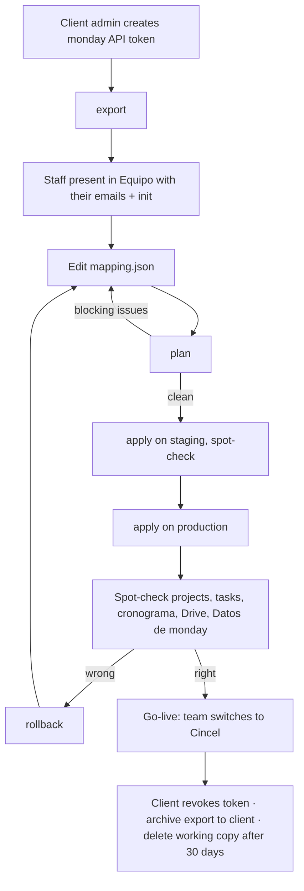

# Spec: One-time monday.com migration (Backend + CLI)

**Status:** Ready for review · **Owner:** Oscar · **Date:** 2026-10-28 · **monday API version:** `2026-07`
**Priority:** first. Built before Staff SSO and the Client Portal (`docs/specs/backend.md`).
**Companion:** `docs/specs/monday-migration/frontend.md` (UI that shows the translated data, child tasks, dependencies, project bitácora).
**Source:** `docs/specs/source/monday-migration-spec.md` (Oscar's draft, 2026-10-28), adapted to the existing `cincel-app`. Where they differ, this spec wins.
**Review:** `docs/review/monday-migration-review.md` (round 1: 9 blocking issues, all addressed here; §14 lists where).

---

## 0. Context and settled decisions

### 0.1 Principle: translate, don't clone

The migration **exports** a client's monday account and **ingests** it into Cincel's own concepts. A monday column doesn't need a same-shaped Cincel field; it needs the right Cincel equivalent. Data without an equivalent is kept per row and shown read-only (frontend §2.3); where useful, a small general Cincel feature is added for it (child tasks, dependencies, project bitácora). The goal is that the client stops using monday, not that Cincel looks like monday.

### 0.2 The existing app this targets

| Concept | Cincel today | Where |
|---|---|---|
| Client / partner / provider | `core.contacts` (`type` `cliente`/`socio`/`proveedor`, `kind` `empresa`/`particular`, `name`, `phone`, `email`, `website`, `location`, `notes`; unique `contacts_type_name_lower_uq` on type + lower(name)), `core.contact_people` (uuid `id`, `contact_id`, `name`, `email`), `core.provider_profiles` (`subtype` NOT NULL) | `lib/db/schema/contacts.ts` |
| Project | `core.projects` (`client_id` NOT NULL, `code` unique `projects_code_uq`, `name` unique per client `projects_client_name_lower_uq`, `status` `activo/pausado/completado/cancelado`, `manager_id`, `coordinator_id`, `progress`, `start_date`, `end_date`, address columns), `project_stages`, `project_members`, `project_contacts`, `project_links` (`kind` `interno`/`cliente`) | `projects.ts` |
| Area / workflow / template | `core.areas`, `core.workflows`, `core.workflow_task_templates`, `core.area_workflows` | `people.ts`, `workflows.ts` |
| Task | `core.tasks`: `kind` `workflow` (needs `template_id` + `workflow_id`; `tasks_project_template_uq`) or `usuario` (`template_id` null; `workflow_id` allowed); `title`, `notes`, `status` `pendiente/en_proceso/completado/bloqueado`, `custom_status_id` → `core.task_statuses` (when set, `status` is derived: `closes` → `completado`, else `en_proceso`, see `underlyingStatus()` in `lib/repositories/task-statuses-repository.ts`), `priority` `alta/media/baja`, `manager_id`, `phase`, dates `commitment_date`/`review_date`/`delivery_date`, `sort_order`, `archived`; `core.task_support` (PK `task_id, staff_id`); `core.task_checklist_items`; `core.task_links` | `tasks.ts` |
| Comments (bitácora) | `core.history_events` (`kind = 'comentario'` needs `comment` and no `field`), `entity` `task`/`project`/`contact`/…; append-only. Task and contact bitácoras exist (`fetchTaskHistoryAction`, `fetchContactHistoryAction`); **projects have none yet** | `shared.ts`, `lib/actions/*` |
| Cronograma | `core.project_schedules` (one per project) + `core.schedule_tasks` (`stable_key`, `planta`, `seccion`, `seccion_order` int NOT NULL, `tarea`, `inicio`, `fin`, `status` `pending/progress/done`, `responsable`, `sort_order` int NOT NULL). The Excel import replaces rows by stable key (`notInArray`) | `schedule.ts`, `lib/actions/schedule-actions.ts` |
| DB access | `lib/db/client.ts` imports `server-only` (throws under plain `tsx`); scripts build their own drizzle client (`scripts/seed.ts`) | |
| Server action style | Existing actions throw `Error` (e.g. `"FORBIDDEN: task edit"`); UI shows the message | `lib/actions/tasks-actions.ts` |
| Types | `lib/types/core.ts`, `lib/types/task.ts`, `lib/types/schedule.ts` | |
| Scripts | `scripts/*.ts` run with `tsx` via **npm** | `package.json` |

### 0.3 Decisions already made (don't revisit)

1. **One-time migration per client.** No sync, delta, webhooks or OAuth app.
2. **A CLI in the repo, run by Oscar:** `scripts/monday/`, `npm run monday -- <command>`. No UI to run it in v1.
3. **Auth to monday:** a personal API token of a client admin, revoked after migration (§2.1).
4. **Export first, import from files.** The export folder is also the client's archive of their monday data.
5. **The mapping is a hand-edited `mapping.json`,** drafted by the tool, then validated.
6. **`plan` (dry run) → `apply` (one DB transaction, then a resumable Drive phase) → `rollback` if wrong.** Re-applying never duplicates.
7. **Rollback only before go-live.** After staff add data to imported rows, fix forward.
8. **People match existing `core.staff` by email** (entered in Equipo today). No Workspace sync needed. Staff SSO later links the same rows by email.
9. **Files go to Google Drive,** into `01 Interno/Importado de monday/<group>` of the project's folder, uploaded by the service account, and linked from Cincel. Never to `02 Cliente` automatically. The Drive pieces this needs are built here first and reused by Staff SSO (§10).
10. **Provenance lives in its own table** (`core.import_refs`), not in `monday_id` columns on core tables.
11. **Subitems:** per board, checklist items or child tasks. **Timelines:** feed task dates **and** the cronograma. **Dependencies:** a new `core.task_dependencies` table with UI (frontend §2.2).

### 0.4 Defaults to confirm (build with these unless told otherwise)

| Topic | Default |
|---|---|
| monday updates (comments) | Imported into the bitácora of the task, project or contact |
| Files | Uploaded to Drive and linked |
| Archived / deleted monday items | Not imported |
| Unmatched assignee | Task without manager; name kept in the import data |
| Comment author not in staff | Comment by the importing admin, prefixed `monday · {original name}:` |
| Subitems | `checklist` |
| Timelines | Task dates on; cronograma on for `board_as_project` boards with a timeline column |
| Project status | `completado` when every top-level item maps to `completado`, else `activo` |

---

## 1. Goals and non-goals

**Goals**
- Move one client's monday account into Cincel in an afternoon: clients, projects, tasks, subitems, status, people, dates, comments, files, dependencies, and the cronograma where there are timelines.
- Nothing silently dropped: data without a Cincel equivalent is kept per row and visible read-only.
- A wrong import is fully undone before go-live, Drive files included.

**Non-goals**
- Sync with monday; re-imports after go-live.
- Archived/deleted items, automations, dashboards, forms, monday docs.
- Dependency types other than finish-to-start (the API doesn't expose them).
- A UI to run the import.

---

## 2. Architecture

```
scripts/monday/
  cli.ts                 entry: export | init | plan | apply | rollback
  db.ts                  its own drizzle client (postgres-js, max 1), like scripts/seed.ts; no server-only
  client.ts              GraphQL client (API-Version header, retries, errors[] handling)
  export.ts              → exports/<client>/
  init.ts                export + Cincel DB → mapping.json (draft)
  mapping.schema.ts      Zod 4 schema for mapping.json
  translate.ts           pure: (export, mapping, cincel lookups) → planned Cincel rows
  plan.ts                validation + plan.md
  apply.ts               phase A (DB transaction), phase B (Drive)
  rollback.ts            DB transaction, then Drive trash
  sanitize.ts            HTML → text (sanitize-html, allowlist p, br, b, i, ul, ol, li, a; links kept as "text (url)")
lib/import/refs.ts           import_refs helpers; every function takes `db` as a parameter (no server-only)
lib/google/drive-admin.ts    service-account Drive client; takes credentials as parameters (no server-only)
lib/google/project-folders.ts ensureProjectFolders(db, drive, projectId, sharedDriveId); idempotent
```

App code that uses `lib/import/*` or `lib/google/*` passes in `db` from `lib/db/client.ts`; the CLI passes its own. Neither shared module imports `server-only` or `lib/db/client.ts`.

### 2.1 Running it

- **Where:** from Oscar's checkout of the repo (dev machine), never inside the production image (it has no `scripts/` or `tsx`). Against production, `DATABASE_URL` points at the prod database through an SSH tunnel to the server; the same for staging first.
- **Commands:**
  ```bash
  npm run monday -- export   --out exports/acme [--boards 123,456] [--no-files] [--no-updates]
  npm run monday -- init     --export exports/acme
  npm run monday -- plan     --export exports/acme
  npm run monday -- apply    --export exports/acme --by oscar@cincel.mx
  npm run monday -- rollback --batch <import_batch_id> [--drive-only]
  ```
- **Token:** read from `MONDAY_TOKEN` if set (e.g. from a git-ignored `.env.monday` loaded by the CLI), else prompted with hidden input. Never passed as a flag, written to disk or logged.
- **Google:** `GOOGLE_SA_CLIENT_EMAIL`, `GOOGLE_SA_PRIVATE_KEY` (existing), `GOOGLE_SHARED_DRIVE_ID` (new, defined here; Staff SSO reuses it): the company Shared Drive where project folders live. The service account must be a Content manager on it.
- **Client data:** `exports/` is in `.gitignore` and `.dockerignore`. It holds client PII and files: keep it on Oscar's encrypted disk, hand a copy to the client as their archive at go-live, and delete the working copy 30 days after go-live.

---

## 3. monday API facts the code depends on

Endpoint `POST https://api.monday.com/v2`, GraphQL, headers `API-Version: 2026-07`, `Authorization: <token>`.

| Fact | Consequence |
|---|---|
| Daily call limit: Free/Basic/Standard 1,000 · Pro 10,000 · Enterprise 25,000 (resets 00:00 UTC) | A typical export is a few hundred calls. Export is resumable per board |
| Personal token complexity: 10M/min combined (1M on trial/free); 5M per query | Page size ~200 with subitems inline |
| Rate-limit errors carry `retry_in_seconds`; minute limits send `Retry-After` | Sleep and retry, max 5 attempts |
| **Application errors arrive as HTTP 200 with `errors[]`,** sometimes with partial `data` | Any `errors[]` = failed page → retry; never write a partial page |
| `items_page` (nested in `boards`) then root `next_items_page`; `limit` ≤ 500 | Standard pagination loop |
| **Cursor expires 60 min** after the first request for that board | If a board dies, restart that board |
| `items_page` returns active items only | Archived/deleted are naturally excluded |
| `boards` without `hierarchy_types` returns only classic boards | Always pass `[classic, multi_level]` |
| `workspace_id` is `null` for the Main workspace | Treat as a real workspace |
| Max 10,000 items per board; item names 1–255 chars | `tasks.title` is `text`: fine |
| Status labels: stable `id` vs display `index` (reorderable). Definitions in `columns { settings }` (`settings_str` deprecated) | **Map statuses by label `id`** |
| `board_relation`, `dependency`, `mirror`: `text` and `value` are always `null` | Use typed fragments |
| Subitems only via `item.subitems`; their own column set; up to 5 levels on multi-level boards | Query nested subitems to 5 levels (§4.2); export subitem board columns |
| Asset `public_url` valid **1 hour** | Download during export, never later |
| `updates(limit ≤ 100, page)` per item, newest first, `body` is HTML | Batch 100 item ids per call; page items that return 100 |
| `users`: `enabled`, `is_guest`, `is_pending`, `is_admin`, `photo_thumb` deprecated in 2026-07, removal scheduled 2026-10 | Use `status` and `kind` |
| Token sees only what its user sees | Use an admin's token; export prints the visible board count |
| Group `position` is a decimal string; items have no position field | Order groups by `position` and items by export order (§5.2) |

---

## 4. Export

### 4.1 Output folder

```
exports/acme/
  manifest.json          account {id, slug, name}, exported_at, api_version, token_user, boards[{id,name,items_count,done}], call_count, errors[]
  users.json             [{id, name, email, status, kind}]
  workspaces.json
  boards/<board_id>/
    board.json           {id, name, workspace_id, columns[{id,title,type,settings}], groups[{id,title,position}], subitem_columns[...]}
    items.ndjson         one item per line in API order, subitems nested (to 5 levels), typed column values, asset refs
    updates.ndjson       one update per line, replies nested, asset refs
    .done                written last; re-run skips boards that have it
  files/
    index.json           asset_id → {name, size, sha256, path, item_id | update_id}
    <asset_id>/<original-name>
```

### 4.2 Queries

```graphql
fragment ItemFields on Item {
  id name state created_at updated_at creator_id
  group { id }
  parent_item { id }
  assets { id name file_extension file_size }
  column_values {
    id type text
    ... on StatusValue        { label index is_done }
    ... on PeopleValue        { persons_and_teams { id kind } }
    ... on TimelineValue      { from to visualization_type }
    ... on BoardRelationValue { linked_item_ids display_value }
    ... on DependencyValue    { linked_item_ids }
    ... on MirrorValue        { display_value }
  }
}

fragment ItemTree on Item {
  ...ItemFields
  subitems { ...ItemFields subitems { ...ItemFields subitems { ...ItemFields subitems { ...ItemFields subitems { ...ItemFields } } } } }
}

query Boards($page: Int!) {
  boards(limit: 100, page: $page, state: active, hierarchy_types: [classic, multi_level]) {
    id name workspace_id items_count
    columns { id title type settings }
    groups { id title position }
  }
}

query FirstPage($board: [ID!], $limit: Int!) {
  boards(ids: $board) { items_page(limit: $limit) { cursor items { ...ItemTree } } }
}

query NextPage($cursor: String!, $limit: Int!) {
  next_items_page(cursor: $cursor, limit: $limit) { cursor items { ...ItemTree } }
}

query Updates($ids: [ID!], $page: Int!) {
  items(ids: $ids, limit: 100) {
    id
    updates(limit: 100, page: $page) {
      id body text_body created_at creator_id
      replies { id body created_at creator_id }
      assets { id name file_extension file_size }
    }
  }
}

query Assets($ids: [ID!]!) { assets(ids: $ids) { id name public_url } }

query Users($page: Int!) { users(limit: 1000, page: $page) { id name email status kind } }
```

- Updates: page 1 for 100 items per call; any item that returned 100 updates is fetched again alone with `page + 1` until it returns fewer.
- Subitem trees use a smaller page size (50) on multi-level boards to stay under the per-query complexity limit; the client lowers the page size and retries if monday reports complexity exceeded.
- Generate types against the 2026-07 schema (`graphql-codegen`, dev dependency) and add `DateValue`, `CheckboxValue`, `NumbersValue`, `EmailValue`, `PhoneValue`. Only the six typed fragments above were verified in the spike.
- For each board with subitems, fetch the subitems board's columns once into `board.json.subitem_columns`.
- Download each asset right after its `public_url` is fetched; store its sha256. A failed download is retried 3 times, then recorded in `manifest.errors[]` (the board still completes).

### 4.3 Call estimate (printed before starting, with a y/N prompt)

`ceil(boards/100) + ceil(items/200) + ceil(items/100) [updates] + ceil(assets/50) [files] + ceil(users/1000)`. Example: 40 boards, 24,000 items, 2,000 files ≈ **400 calls**.

---

## 5. Translation model

### 5.1 Board strategies

| Strategy | Detected when | monday → Cincel |
|---|---|---|
| `board_as_project` | default | board → project · group → `tasks.phase` (and cronograma `seccion`) · item → task · subitem → checklist item or child task |
| `group_as_project` | admin chooses | group → project · item → task |
| `item_as_project` | most items have subitems | item → project · subitem → task |
| `crm_contacts` | email/phone columns dominate | item → contact (`contactType` from the mapping) |
| `skip` | — | nothing |

### 5.2 Concept translation

| monday | Cincel |
|---|---|
| Item name | `tasks.title` (projects: `projects.name`, overridable per project in `projectNames`; contacts: `contacts.name`) |
| Group | `tasks.phase`; cronograma `seccion`. Order: groups sorted by `position` (decimal), then dense rank 1..n → `seccion_order` |
| Item order | Export order within its group → `tasks.sort_order` and `schedule_tasks.sort_order` (1..n, integers) |
| Status column | Per label id: `{ status }` → `tasks.status`; or `{ customStatusId }` → `tasks.custom_status_id` with `tasks.status = underlyingStatus(customStatus)` (never set independently). Defaults: `is_done` → `completado`; `/stuck\|bloquead\|detenid/i` → `bloqueado`; `/working\|proceso\|curso/i` → `en_proceso`; else `pendiente`; a label whose text equals an existing `task_statuses.name` (case-insensitive) → that custom status |
| Priority-like status column (`/prior/i` title) | `tasks.priority`: `/alta\|high\|urgent/i` → `alta`, `/baja\|low/i` → `baja`, else `media` |
| People column | First person → `tasks.manager_id`; the rest → `core.task_support`. Matched by `lower(email)` to `core.staff`. Guests → a `contact_people` row of the project's client when `people[id] = { action: "contact" }` |
| Timeline | `to` → `commitment_date`; `from` → import data `start` and cronograma `inicio`; `visualization_type = milestone` → import data `milestone: true` |
| Date column (first one, or the mapped one) | `delivery_date` |
| Long text / text (first one) | `tasks.notes` |
| Dependency | `core.task_dependencies` (finish-to-start), §8 |
| Connect boards to a `crm_contacts` board | The project's client when the item/board becomes a project; otherwise import data |
| Mirror, numbers, formula, other columns | Import data (`import_refs.data.columns`), keyed by column **title**; a duplicate title on the same board gets `#<columnId>` appended |
| Subitems, `subitems: "checklist"` | `task_checklist_items` (title = name, `completed` = mapped status is `completado`, `sort_order` = position); their column values kept in the parent task's import data under `subitems[<subitemId>] = { name, columns }`. Deeper levels become checklist items too, in depth-first order, title prefixed with the parent subitem's name (`"Muros › Aplanado"`) |
| Subitems, `subitems: "child_tasks"` | Tasks with `parent_task_id` = the item's task, translated like items using `subitemColumns`. Levels below the first are flattened to the first child level (one level of nesting, frontend §2.1), with `path` in import data |
| Updates and replies | `history_events` (`kind = 'comentario'`), oldest first, `event_at` = monday `created_at`, `actor_id` = mapped staff, else the importing admin with the `monday · {name}:` prefix, text sanitized. `entity`: `task` for items/subitems that are tasks; `project` for `item_as_project` items; `contact` for `crm_contacts` items; updates on subitems in checklist mode go to the parent task, prefixed `[{subitem name}]` |
| Files on items and updates | Uploaded to Drive (§7 phase B) and linked: on tasks → `task_links` (`kind = 'interno'`, title = file name, url = Drive `webViewLink`); on projects (`item_as_project`) → `project_links` (`kind = 'interno'`); plus a `drive_files` cache row. Files on checklist-mode subitems go to the parent task |
| Item `created_at` | `tasks.created_at`; `created_by_id` = the importing admin |
| Workflow task | If the item is in `templateMatches`: `kind = 'workflow'` with that `template_id` and its `workflow_id`. Else `kind = 'usuario'` with `workflow_id` = the board's `workflowId` (when set), so the task shows under that department in Actividades |
| `crm_contacts` with `contactType = 'proveedor'` | Also a `provider_profiles` row with the mapping's `providerSubtype` |
| Source of every row | `import_refs.data.source = { boardId, boardName, groupId, groupTitle }` |

### 5.3 `init` (no monday calls; reads the export and the Cincel DB)

- **People:** monday email (lowercase) → `core.staff.email` → `{ action: "staff", staffId }`; guests → `{ action: "contact" }`; no match → `null`.
- **Strategy** per board from §5.1; **columns** by type per §5.2; **status maps** by label id per §5.2.
- **Client** per project: connect-boards to a CRM board → `relation_column`; else trigram match of the board or group name to `contacts.name` where `type = 'cliente'` (≥ 0.8) → `contact`; else `null`.
- **Existing contacts for `crm_contacts`:** an item whose name matches an existing contact of the same type (lower-case equal) → `contactMatches[itemId] = contactId` (reuse, don't create).
- **Area / workflow** per board: trigram match of the workspace name to `areas.name` → `areaId`; if that area has exactly one workflow → `workflowId`. Template matches: item names vs that workflow's templates (≥ 0.85).
- **Cronograma:** `schedule.enabled = true` for `board_as_project` boards with a timeline column.
- Trigram similarity runs in Postgres (`pg_trgm` is enabled by migration 0000).

### 5.4 Mapping schema

```ts
// scripts/monday/mapping.schema.ts (Zod 4)
import { z } from "zod";

export const ColumnTarget = z.enum([
  "title", "notes", "status", "priority", "people", "commitment_date", "delivery_date",
  "timeline", "dependencies", "files", "client", "contact_email", "contact_phone",
  "import_data", "ignore",
]);

export const ClientRef = z.discriminatedUnion("kind", [
  z.object({ kind: z.literal("contact"), contactId: z.uuid() }),
  z.object({ kind: z.literal("relation_column"), columnId: z.string() }),
  z.object({ kind: z.literal("new"), name: z.string().min(1), contactKind: z.enum(["empresa", "particular"]).default("empresa") }),
]);

export const StatusTarget = z.union([
  z.object({ status: z.enum(["pendiente", "en_proceso", "completado", "bloqueado"]) }),
  z.object({ customStatusId: z.uuid() }),            // tasks.status derived via underlyingStatus()
]);

export const BoardMapping = z.object({
  mondayBoardId: z.string(),
  name: z.string(),
  strategy: z.enum(["board_as_project", "group_as_project", "item_as_project", "crm_contacts", "skip"]),
  contactType: z.enum(["cliente", "socio", "proveedor"]).optional(),         // crm_contacts
  providerSubtype: z.string().optional(),                                    // crm_contacts + proveedor: a core.provider_subtype value
  contactMatches: z.record(z.string(), z.uuid()).default({}),                // crm_contacts: monday item id → existing contact
  areaId: z.uuid().nullable().optional(),
  workflowId: z.uuid().nullable().optional(),                                // usuario tasks' workflow (Actividades department)
  client: ClientRef.nullable().optional(),
  groupClients: z.record(z.string(), ClientRef).optional(),                  // group_as_project: groupId → client
  projectCode: z.string().optional(),                                        // board_as_project
  projectNames: z.record(z.string(), z.string()).default({}),                // board/group/item id → project name override
  projectCodes: z.record(z.string(), z.string()).default({}),                // group/item id → code (other strategies)
  columns: z.record(z.string(), ColumnTarget),
  subitemColumns: z.record(z.string(), ColumnTarget).default({}),
  statusMaps: z.record(z.string(), z.record(z.string(), StatusTarget)),     // columnId → { labelId → target }
  subitems: z.enum(["checklist", "child_tasks", "ignore"]).default("checklist"),
  schedule: z.object({
    enabled: z.boolean(),
    planta: z.union([z.object({ fixed: z.string().min(1) }), z.object({ columnId: z.string() })]).default({ fixed: "General" }),
  }).default({ enabled: false, planta: { fixed: "General" } }),
  templateMatches: z.record(z.string(), z.uuid()).default({}),               // monday item id → workflow_task_templates.id
});

export const Mapping = z.object({
  version: z.literal(1),
  boards: z.array(BoardMapping),
  people: z.record(z.string(), z.union([
    z.object({ action: z.literal("staff"), staffId: z.uuid() }),
    z.object({ action: z.literal("contact"), contactId: z.uuid().optional() }),
    z.object({ action: z.literal("ignore") }),
    z.null(),
  ])),
  options: z.object({
    includeUpdates: z.boolean().default(true),
    includeFiles: z.boolean().default(true),
  }),
});
export type Mapping = z.infer<typeof Mapping>;
```

---

## 6. Plan (dry run)

Reads the export, the mapping and the Cincel DB; writes only `exports/<client>/plan.md` and prints a summary. It runs every constraint check `apply` would hit, so a clean plan never fails mid-transaction.

- Per board: contacts, projects, tasks, child tasks, checklist items, dependencies, comments, cronograma rows and files to create, and rows skipped because they were already imported (`import_refs`).
- Issues:

| Code | Blocks apply | Meaning |
|---|---|---|
| `MAPPING_INVALID` | yes | Zod validation failed (path + message) |
| `CLIENT_UNRESOLVED` | yes | A project would have no client (`projects.client_id` NOT NULL) |
| `CONTACT_NAME_TAKEN` | yes | A new contact's type + lower(name) exists already (`contacts_type_name_lower_uq`), or appears twice in the import. Fix with `contactMatches` (reuse) or rename in monday |
| `PROJECT_NAME_TAKEN` | yes | A new project's client + lower(name) exists, or appears twice (`projects_client_name_lower_uq`). Fix with `projectNames` |
| `PROJECT_CODE_TAKEN` | yes | A project code exists or repeats (`projects_code_uq`). Fix with `projectCode` / `projectCodes` |
| `STATUS_UNMAPPED` | yes | A status label id used by an item has no target |
| `TEMPLATE_COLLISION` | yes | Two items in one project matched the same template (`tasks_project_template_uq`) |
| `TEMPLATE_INVALID` | yes | A template id doesn't exist or isn't in a workflow of the board's area |
| `PROVIDER_SUBTYPE_MISSING` | yes | `crm_contacts` as `proveedor` without a valid `providerSubtype` |
| `SCHEDULE_EXISTS` | yes | `schedule.enabled` but the project already has a `project_schedules` row not created by this import |
| `DRIVE_NOT_CONFIGURED` | yes (if files on) | Service account or `GOOGLE_SHARED_DRIVE_ID` missing, or the service account can't list the Shared Drive |
| `PERSON_UNMATCHED` | no | Assignee left empty; name kept in import data |
| `RELATION_MISSING` | no | Linked or depended-on item not in the export |
| `DATES_MISSING` | no | An item without a timeline value is left out of the cronograma (still a task) |
| `FILE_MISSING` | no | An asset is in the index but not on disk (failed download) |

Loop: edit `mapping.json` → `plan` until no blocking issues.

### 6.1 Cronograma rows (when `schedule.enabled`)

For each item with a timeline value: one `schedule_tasks` row: `stable_key = "monday:<itemId>"`, `planta` from the mapping, `seccion` = group title, `seccion_order` = group dense rank, `tarea` = item name, `inicio`/`fin` from the timeline, `status` from the item's mapped status (`completado` → `done`, `en_proceso` → `progress`, else `pending`), `responsable` = the manager's name, `sort_order` = item order. One `project_schedules` row per project (`source_file_name = "monday:<boardId>"`).

Later, an Excel cronograma import for the same project replaces the whole cronograma, `monday:*` rows included: one cronograma has one source at a time. The import screen already says it replaces; no change.

---

## 7. Apply

```mermaid
sequenceDiagram
  autonumber
  actor O as Oscar
  participant C as CLI apply
  participant DB as Postgres
  participant S as Drive API (service account)
  O->>C: npm run monday -- apply --export exports/acme --by oscar@cincel.mx
  C->>DB: open batch for this account in status applying?
  alt yes
    C->>C: skip phase A, resume phase B for that batch
  else no
    C->>C: run plan · abort on any blocking issue
    rect rgb(240,240,240)
    Note over C,DB: Phase A · one DB transaction
    C->>DB: insert import_batches (applying)
    C->>DB: contacts (+contact_people, provider_profiles) → projects → project_schedules → tasks → child tasks → checklist → task_support → task_dependencies → history_events → schedule_tasks
    C->>DB: import_files (pending) · import_refs for every created row (with row_updated_at)
    C->>DB: commit
    end
  end
  Note over C,S: Phase B · Drive, idempotent and resumable
  loop each imported project
    C->>S: ensureProjectFolders + "01 Interno/Importado de monday/<group>"
    C->>DB: project drive_* columns; refresh import_refs.row_updated_at for the project
    loop each pending import_files row
      C->>S: resumable upload from the export folder
      C->>DB: drive_files + task_links / project_links (with import_refs), import_files.drive_file_id
    end
  end
  C->>DB: import_batches.status = applied · stats
  C-->>O: summary + batch id
```

Rules:
- `--by` must be an active `core.staff` email; that staff member is `created_by_id` and the fallback comment author.
- **Resume:** `apply` first looks for a batch with the same `account_id` in status `applying`; if found it resumes phase B only. Otherwise it runs `plan`; rows already in `import_refs` are skipped, so a second `apply` of the same export creates a batch with nothing in it and says "Nada nuevo que importar" (the empty batch is marked `applied`).
- Every created row gets an `import_refs` row; `row_updated_at` = the row's `updated_at` after insert (null for rows without one).
- Project `progress` = % of top-level tasks `completado`; `start_date`/`end_date` = min/max of task dates; `status` per §0.4.
- Comments keep the original `event_at`; no `cambio` history rows are generated for imported values.
- Files go to `01 Interno/Importado de monday/<group name>`; staff move client-relevant files to `02 Cliente` themselves.
- Project folders: if `drive_folder_id` is already set, only the import subfolder is added.

---

## 8. Schema

One Drizzle migration, all with `core.table()` / `core.enum()`.

```ts
// lib/db/schema/import.ts
export const importBatchStatus = core.enum("import_batch_status", ["applying", "applied", "rolled_back"]);

export const importBatches = core.table("import_batches", {
  id: uuid("id").primaryKey().defaultRandom(),
  source: text("source").notNull().default("monday"),
  accountId: text("account_id").notNull(),
  accountSlug: text("account_slug"),
  accountName: text("account_name"),
  exportedByEmail: text("exported_by_email"),
  exportedAt: timestamp("exported_at", { withTimezone: true }).notNull(),
  exportPath: text("export_path").notNull(),
  apiVersion: text("api_version").notNull().default("2026-07"),
  mapping: jsonb("mapping").notNull(),
  stats: jsonb("stats").notNull().default(sql`'{}'::jsonb`),
  status: importBatchStatus("status").notNull().default("applying"),
  appliedById: uuid("applied_by_id").notNull().references(() => staff.id),
  appliedAt: timestamp("applied_at", { withTimezone: true }).notNull().defaultNow(),
  rolledBackAt: timestamp("rolled_back_at", { withTimezone: true }),
  ...stamps,
}, (t) => [index("idx_import_batches_account_status").on(t.accountId, t.status)]);

/** One row per Cincel row an import created: provenance, untranslated data, change snapshot. */
export const importRefs = core.table("import_refs", {
  source: text("source").notNull(),            // "monday"
  entity: text("entity").notNull(),
  // contact | contact_person | provider_profile | project | project_schedule | task | checklist_item |
  // task_support | task_dependency | history_event | schedule_task | task_link | project_link | drive_file
  externalId: text("external_id").notNull(),   // monday id; task_support: "<itemId>:<mondayUserId>"; group: "<boardId>:<groupId>"
  rowId: uuid("row_id").notNull(),             // the Cincel row id; task_support: the task id (staff id in data.staffId)
  batchId: uuid("batch_id").notNull().references(() => importBatches.id, { onDelete: "restrict" }),
  data: jsonb("data"),                         // { source: {boardId, boardName, groupId, groupTitle}, columns: {...}, subitems?, start?, milestone?, path?, staffId? }
  rowUpdatedAt: timestamp("row_updated_at", { withTimezone: true }),   // snapshot for the rollback change check
  createdAt: timestamp("created_at", { withTimezone: true }).notNull().defaultNow(),
}, (t) => [
  primaryKey({ columns: [t.source, t.entity, t.externalId] }),
  index("idx_import_refs_row").on(t.entity, t.rowId),
  index("idx_import_refs_batch").on(t.batchId),
]);

/** Files waiting for / done with the Drive upload (phase B). */
export const importFiles = core.table("import_files", {
  id: uuid("id").primaryKey().defaultRandom(),
  batchId: uuid("batch_id").notNull().references(() => importBatches.id, { onDelete: "restrict" }),
  assetId: text("asset_id").notNull(),
  projectId: uuid("project_id").notNull().references(() => projects.id),
  taskId: uuid("task_id").references(() => tasks.id),      // null → project link
  groupName: text("group_name"),
  fileName: text("file_name").notNull(),
  sizeBytes: bigint("size_bytes", { mode: "number" }),
  sha256: text("sha256").notNull(),
  localPath: text("local_path").notNull(),
  driveFileId: text("drive_file_id"),                       // null = pending
  error: text("error"),
  ...stamps,
}, (t) => [uniqueIndex("import_files_batch_asset_uq").on(t.batchId, t.assetId)]);
```

```ts
// lib/db/schema/projects.ts — project Drive columns (owned by this migration; Staff SSO reuses them, §10)
export const driveFolderStatus = core.enum("drive_folder_status", ["pending", "ready", "failed"]);
driveFolderId: text("drive_folder_id"),
driveInternalFolderId: text("drive_internal_folder_id"),   // "01 Interno"
driveClientFolderId: text("drive_client_folder_id"),       // "02 Cliente"
driveInboundFolderId: text("drive_inbound_folder_id"),     // "03 Del cliente"
driveImportFolderId: text("drive_import_folder_id"),       // "01 Interno/Importado de monday"
driveFolderStatus: driveFolderStatus("drive_folder_status").notNull().default("pending"),
driveFolderError: text("drive_folder_error"),
```

```ts
// lib/db/schema/tasks.ts — additions (general task features, frontend §2)
parentTaskId: uuid("parent_task_id").references((): AnyPgColumn => tasks.id, { onDelete: "set null" }),
// + index("idx_tasks_parent_task_id").on(t.parentTaskId)
// One level of nesting: a task with a parent can't be a parent (checked in actions and the import).

export const dependencyKind = core.enum("dependency_kind", ["finish_to_start"]);

export const taskDependencies = core.table("task_dependencies", {
  id: uuid("id").primaryKey().defaultRandom(),
  taskId: uuid("task_id").notNull().references(() => tasks.id, { onDelete: "cascade" }),             // the dependent task
  dependsOnTaskId: uuid("depends_on_task_id").notNull().references(() => tasks.id, { onDelete: "cascade" }),
  kind: dependencyKind("kind").notNull().default("finish_to_start"),
  ...stamps,
}, (t) => [
  uniqueIndex("task_dependencies_pair_uq").on(t.taskId, t.dependsOnTaskId),
  index("idx_task_dependencies_depends_on").on(t.dependsOnTaskId),
  check("task_dependencies_not_self", sql`${t.taskId} <> ${t.dependsOnTaskId}`),
]);
```

monday ids are numeric and unique across accounts, so (`source`, `entity`, `external_id`) holds with several clients in one database. Confirm on the first two real exports.

---

## 9. Rollback and cutover

```bash
npm run monday -- rollback --batch <id> [--drive-only]
```

1. **Refuse** if anything outside the batch touched or depends on a batch row. Print every blocker (table, id, what):
   - a batch row whose current `updated_at` differs from `import_refs.row_updated_at` (someone edited it);
   - `history_events` on a batch task, project or contact that aren't in `import_refs` (a comment or change by someone);
   - rows not in `import_refs` that point at a batch row: tasks, child tasks (`parent_task_id`), checklist items, `task_support`, `task_links`, `task_dependencies` (either side), `project_links`, `project_contacts`, `project_members`, `project_stages`, `schedule_tasks`, projects whose `client_id` is a batch contact, `schedule_tasks.responsable_contact_id`, `provider_profiles`, `contact_people`;
   - (once the portal exists) `project_portal_access` rows on a batch project.
   That's the signal to fix forward.
2. **One DB transaction:** first write the list of Drive ids to trash (uploaded files, import folders, project folders the batch created) into `import_batches.stats.driveTrash`, so `--drive-only` can retry after the rows are gone; then delete batch rows in reverse order: `task_links`, `project_links`, `drive_files` → `history_events` → `schedule_tasks` → `project_schedules` → `task_dependencies` → `task_checklist_items` → `task_support` (by task id + `data.staffId`) → child tasks → tasks → projects → `provider_profiles` → `contact_people` → contacts; then `import_files` and `import_refs` of the batch; `import_batches.status = rolled_back`, `rolled_back_at`. This is the one sanctioned exception to "nunca eliminar historial": the rows are the import's own and unchanged (step 1).
3. **After commit, Drive:** trash (not delete; recoverable 30 days) the uploaded files and the import folders; project folders the batch created are trashed too, folders that existed before are kept. Failures are listed; `rollback --batch <id> --drive-only` retries the Drive step for a `rolled_back` batch from `stats.driveTrash`, recording what's done in `stats.driveTrashed`.

### Runbook per client



---

## 10. Ownership of the Drive pieces (Staff SSO hand-off)

This migration ships first, so it owns the Drive foundations; Staff SSO builds on them:

| Piece | Owner | Notes |
|---|---|---|
| Project Drive columns + `drive_folder_status` enum + `drive_import_folder_id` (§8) | **Migration Phase 1** | Removed from Staff SSO's Part A migration (issue #482, `docs/specs/backend.md` §A.3) |
| `lib/google/drive-admin.ts`: create folder, rename, get (id, name, parents, trashed), list, get media, export, resumable upload, **trash** | **Migration Phase 1** | Issue #483 moves to the migration milestone; `trash` added |
| `ensureProjectFolders(db, drive, projectId, sharedDriveId)` (folder + `01 Interno` / `02 Cliente` / `03 Del cliente`, idempotent) | **Migration Phase 1** | Pure function, called by the CLI only |
| `GOOGLE_SHARED_DRIVE_ID` env var and the Shared Drive setup | **Migration Phase 1** | Staff SSO reuses it |
| `createProject` `after()` hook, rename sync, `retryProjectFolderAction`, `ensureMissingProjectFoldersAction`, **Crear carpetas faltantes** UI | **Staff SSO Phase 3** | Unchanged there (#489, #494, #540); they call the function above. Until then, projects created in the app get no folder automatically |

- Staff SSO sign-in links staff by email, so imported `manager_id` / `task_support` references stay valid.
- The Client Portal shows imported projects normally; nothing reaches `02 Cliente` from the import.

## 11. Testing

- **Unit (Vitest), with fixture exports in `scripts/monday/__fixtures__/`:** GraphQL client (`errors[]` with 200, `retry_in_seconds`, `Retry-After`, max attempts, cursor expiry restart, complexity → smaller page); export resume (`.done`); update paging past 100; nested subitems to 5 levels; Zod mapping; `init` heuristics; every row of §5.2 (status by label id, reordered labels give the same result, custom status derivation; group dense rank; subitems both modes; timeline → dates and cronograma; dependencies; guests; files → links; duplicate column titles); `plan` issue codes including the three uniqueness checks; HTML sanitizing.
- **Integration (test Postgres, Drive faked):** apply creates exactly the plan counts and `import_refs`; apply twice creates nothing; apply with a blocking issue writes nothing; phase B resume without duplicate uploads; rollback removes everything after phase B ran; rollback refuses after a staff comment, an edit, a new project for an imported client, and a manual dependency, naming each.
- **Manual:** end-to-end on the first real client's export against staging before go-live.

## 12. Acceptance criteria

1. Export of a test account produces §4.1; killing it mid-way and re-running skips `.done` boards; an item with 150 updates keeps all of them.
2. `init` writes a mapping that passes Zod; `plan` lists every blocking issue with board and item ids.
3. `apply` with a blocking issue refuses and writes nothing; a clean `plan` never leads to a constraint error in `apply`.
4. A clean `apply` creates the counts in `plan.md`; every created row has an `import_refs` row.
5. Running `apply` again creates nothing new.
6. Statuses map by label id: reordering labels in monday between two exports doesn't change results; a custom-status target sets `status` by `underlyingStatus`.
7. Subitems become checklist items or child tasks per the board's option; timelines fill task dates and, where enabled, the cronograma in the right section order.
8. Dependencies exist in `task_dependencies` and show in the task drawer; child tasks show under their parent (frontend §2).
9. Untranslated values are visible in **Datos de monday** on tasks, projects and contacts; project-level comments show in the project's **Bitácora** (frontend §2.3, §2.4).
10. Files appear in `01 Interno/Importado de monday/<group>` and as links on their task or project, never in `02 Cliente`.
11. Killing `apply` during phase B and re-running finishes uploads without duplicates.
12. `rollback` after phase B removes all batch rows in one transaction and then trashes its Drive files and folders; after a staff comment on an imported task, it refuses and names it.

## 13. Open questions

1. Confirm the §0.4 defaults with the first client.
2. Once comments support non-staff authors, should unmatched monday authors become contacts? v1 uses the admin + prefix.

## 14. Review round 1: where each blocking issue is addressed

1. `server-only` under `tsx` → §2 (CLI `db.ts`, shared modules take `db`), §0.2.
2. Unique indexes → §6 (`CONTACT_NAME_TAKEN`, `PROJECT_NAME_TAKEN`, `PROJECT_CODE_TAKEN`), §5.4 (`contactMatches`, `projectNames`, `projectCodes`).
3. Composite-key rows → §8 (`task_dependencies.id`, `task_support` / `contact_person` / `provider_profile` encodings), §9 order.
4. `updated_at` check → §8 `row_updated_at`, §7 phase B refresh, §9 step 1.
5. Rollback blockers, transaction, Drive after commit → §9.
6. Integer order columns → §3, §5.2, §6.1.
7. Custom status derivation → §5.2, §5.4 `StatusTarget`.
8. Drive ownership → §0.3.9, §10; `docs/specs/backend.md` §A.3/§A.6.1 and the Staff SSO phase docs updated to match.
9. Project comments invisible → frontend §2.4 (project Bitácora).
