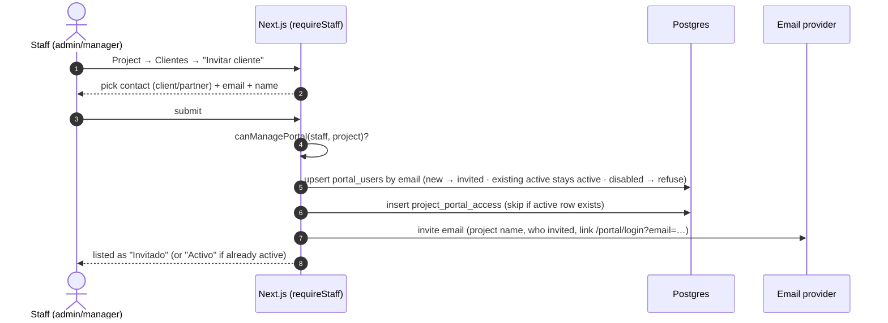
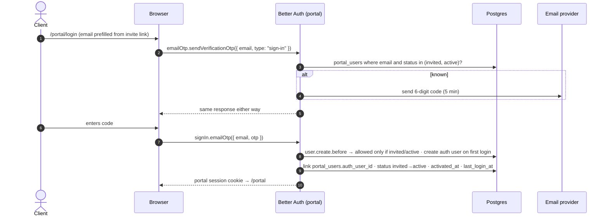
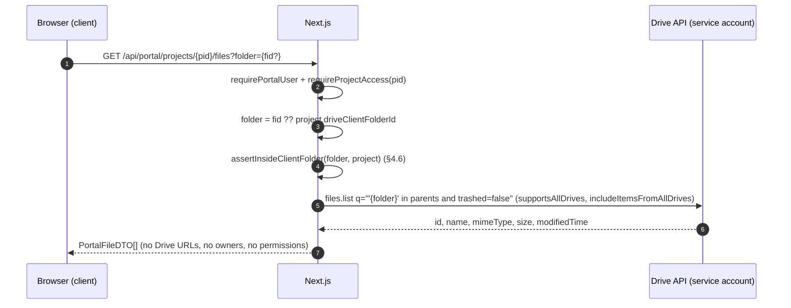
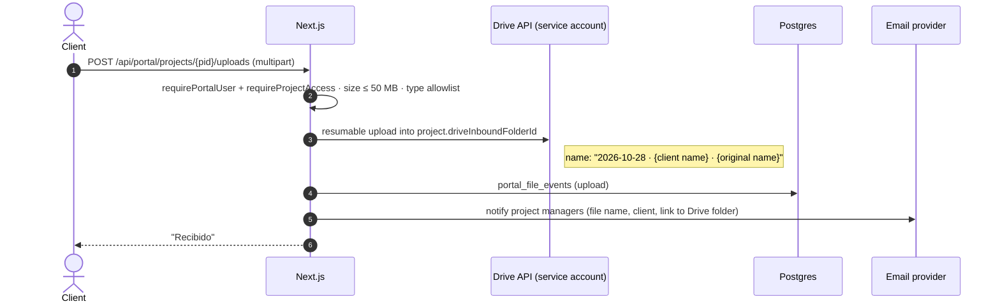

# Cincel Workspace: Client Portal (invited clients, their files only)

**Spec 2 of 2** · Depends on: `cincel-staff-sso-spec.md` (staff auth, `requireStaff()`, service account, project Drive folders)
**Status:** Ready to implement · **Owner:** Oscar · **Date:** 2026-10-28

---

## 0. Context for the implementer

- Same app as spec 1: Next.js (App Router) + TypeScript + Drizzle (Postgres) + shadcn/ui + Tailwind; Better Auth.
- **Staff** sign in with Google Workspace (spec 1). **Clients** are people outside the company's domain: homeowners, client companies, their architects. Most have Gmail/Hotmail/corporate email, and many have no Google account.
- Each project already has a Drive folder in its area's Shared Drive with three subfolders (spec 1 §4.5):
  - `01 Interno`: staff only
  - `02 Cliente`: **visible to the project's invited clients**
  - `03 Del cliente`: **client uploads land here**
- UI copy is in Spanish (Mexico).

### Decisions already made (don't revisit)
1. **Clients have their own login, separate from staff:** a second Better Auth instance with its own tables, routes and cookie. A client session can never satisfy `requireStaff()`, and a staff session can never satisfy `requirePortalUser()`.
2. **Clients sign in with an emailed one-time code** (Better Auth `emailOTP` plugin). No passwords. Google sign-in for clients is phase 2 (§9).
3. **Access is by explicit invitation per project.** No invitation, no access, even if the person is the project's client contact.
4. **Cincel is the gate for client files, not Drive.** The service account lists and streams files from `02 Cliente`. Clients never get Drive permissions and never see Drive links. One rule decides visibility: *a file is visible to a project's invited clients if and only if it's inside that project's `02 Cliente` folder.*
5. **Google Docs/Sheets/Slides are delivered as PDF.** No live editing or commenting by clients.
6. **Clients see a read-only view:** summary, cronograma, their files, and an upload box. They never see internal tasks, comments, staff-only files or other projects.

### Defaults to confirm with the client (build with these unless told otherwise)

| Topic | Default |
|---|---|
| Who can invite / revoke | `admin`, and `manager` for projects in their areas |
| Who can be invited | Contacts of type `client` or `partner` (partner shows a warning) |
| What the cronograma shows | Partidas, dates, % progress, milestones. No task names below partida level, no assignees, no comments |
| Upload limits | 50 MB per file; PDF, images (jpg/png/heic), Office docs, DWG/DXF, ZIP |
| Session length | 30 days, sliding |
| Notify staff on client upload | Email to the project's managers |

---

## 1. Goals and non-goals

### Goals
- Staff invite a client to a project in two clicks; the client gets an email and is in within a minute.
- A client sees only the projects they're invited to and only the files staff put in `02 Cliente`.
- Clients can send files to the team without email attachments.
- Revoking access takes effect immediately.
- Every client download and upload is logged.

### Non-goals (v1)
- Client editing or commenting on Google Docs.
- Client messaging/chat with staff.
- Client-visible tasks or approvals.
- Branding per client.
- Google sign-in for clients (phase 2).

---

## 2. Architecture

```
Browser (client) ──► Next.js
                      ├── /portal/*                 portal pages (Spanish)
                      ├── /api/portal-auth/*        Better Auth instance #2 (emailOTP), cookie prefix "cincel-portal"
                      ├── server: requirePortalUser() + requireProjectAccess()
                      ├── /api/portal/files/*       list / download / upload via service account
                      └── server: driveAdmin        Drive API as service account (from spec 1)
Browser (staff)  ──► /app/projects/[id]/clientes     invite / revoke UI (requireStaff)
Postgres: portal_auth_* (Better Auth) · portal_users · project_portal_access · portal_file_events
Email provider: invites, OTP codes, upload notifications
```

### Second Better Auth instance

```ts
// lib/portal-auth.ts (sketch; verify option names against the installed version)
export const portalAuth = betterAuth({
  basePath: "/api/portal-auth",
  database: drizzleAdapter(db, { provider: "pg" }),
  user:         { modelName: "portal_auth_user" },
  session:      { modelName: "portal_auth_session", expiresIn: 60 * 60 * 24 * 30, updateAge: 60 * 60 * 24 },
  account:      { modelName: "portal_auth_account" },
  verification: { modelName: "portal_auth_verification" },
  advanced:     { cookiePrefix: "cincel-portal" },
  plugins: [
    emailOTP({
      otpLength: 6,
      expiresIn: 300,        // 5 min
      allowedAttempts: 3,
      async sendVerificationOTP({ email, otp, type }) {
        // Only send if email belongs to an invited/active portal user. Otherwise do nothing.
        // Don't await the send (timing); on serverless use waitUntil.
      },
    }),
  ],
  databaseHooks: {
    user: {
      create: {
        before: async (u) => {
          // Allow creation only if portal_users has this email with status invited|active.
          // Throw otherwise. Link portal_users.auth_user_id after create.
        },
      },
    },
  },
});
```

- Mount at `app/api/portal-auth/[...all]/route.ts`.
- Generate its tables with the Better Auth CLI into the Drizzle schema, alongside spec 1's tables.
- **Respond identically for unknown emails** on "send code": "Si tu correo tiene acceso, te enviamos un código." No account enumeration.

---

## 3. Data model

```ts
// db/schema/portal.ts
import { pgTable, pgEnum, uuid, text, integer, timestamp, uniqueIndex, index } from "drizzle-orm/pg-core";
import { sql } from "drizzle-orm";
import { portalAuthUser } from "./portal-auth";   // Better Auth generated
import { contacts } from "./contacts";
import { projects } from "./projects";
import { staff } from "./staff";

export const portalUserStatus = pgEnum("portal_user_status", ["invited", "active", "disabled"]);

export const portalUsers = pgTable("portal_users", {
  id: uuid("id").primaryKey().defaultRandom(),
  email: text("email").notNull().unique(),                 // lowercase; the login identity
  name: text("name").notNull(),
  contactId: uuid("contact_id").notNull().references(() => contacts.id),
  status: portalUserStatus("status").notNull().default("invited"),
  authUserId: text("auth_user_id").unique().references(() => portalAuthUser.id, { onDelete: "set null" }),
  invitedByStaffId: uuid("invited_by_staff_id").notNull().references(() => staff.id),
  invitedAt: timestamp("invited_at", { withTimezone: true }).notNull().defaultNow(),
  activatedAt: timestamp("activated_at", { withTimezone: true }),
  lastLoginAt: timestamp("last_login_at", { withTimezone: true }),
  disabledAt: timestamp("disabled_at", { withTimezone: true }),
});

export const projectPortalAccess = pgTable("project_portal_access", {
  id: uuid("id").primaryKey().defaultRandom(),
  projectId: uuid("project_id").notNull().references(() => projects.id, { onDelete: "cascade" }),
  portalUserId: uuid("portal_user_id").notNull().references(() => portalUsers.id, { onDelete: "cascade" }),
  grantedByStaffId: uuid("granted_by_staff_id").notNull().references(() => staff.id),
  grantedAt: timestamp("granted_at", { withTimezone: true }).notNull().defaultNow(),
  revokedByStaffId: uuid("revoked_by_staff_id").references(() => staff.id),
  revokedAt: timestamp("revoked_at", { withTimezone: true }),
}, (t) => ({
  activeUq: uniqueIndex("project_portal_access_active_uq")
    .on(t.projectId, t.portalUserId)
    .where(sql`${t.revokedAt} is null`),
}));

export const portalFileAction = pgEnum("portal_file_action", ["download", "preview", "upload"]);

export const portalFileEvents = pgTable("portal_file_events", {
  id: uuid("id").primaryKey().defaultRandom(),
  portalUserId: uuid("portal_user_id").notNull().references(() => portalUsers.id),
  projectId: uuid("project_id").notNull().references(() => projects.id),
  driveFileId: text("drive_file_id").notNull(),
  fileName: text("file_name").notNull(),
  sizeBytes: integer("size_bytes"),
  action: portalFileAction("action").notNull(),
  ip: text("ip"),
  userAgent: text("user_agent"),
  at: timestamp("at", { withTimezone: true }).notNull().defaultNow(),
}, (t) => ({ projectAtIdx: index("portal_file_events_project_at_idx").on(t.projectId, t.at) }));
```

Uses from spec 1: `projects.driveClientFolderId`, `projects.driveInboundFolderId`, `projects.driveFolderStatus`.

---

## 4. Flows

### 4.1 Invite a client (staff side)



- One person can be invited to many projects; each invite adds an access row.
- Re-sending an invite (button) sends the email again; rate limit 3/hour per portal user.
- If the email matches a staff member's domain, refuse: "Este correo es de tu equipo; usa el acceso con Google."
- If `driveFolderStatus != ready`, still allow the invite. The client sees "Los archivos estarán disponibles pronto" until folders exist.

### 4.2 Client sign-in



- 3 wrong codes → code invalid; request a new one.
- Rate limit "send code": 5/hour per email and 20/hour per IP.
- `status = disabled` → no code is sent, and existing sessions were already deleted at disable time.

### 4.3 Every portal request

```ts
requirePortalUser()        // portal session → portal_users; status must be active; else sign out → /portal/login
requireProjectAccess(pid)  // active project_portal_access row for (pid, portalUserId) AND project not archived; else 404
```

- Return **404, not 403,** for projects without access, so IDs can't be probed.
- Portal pages and routes **never reuse staff queries.** They call portal query functions that return explicit DTOs:

```ts
type PortalProjectDTO = {
  id: string; name: string; code: string; address?: string;
  status: string; progressPct: number;
  startDate?: string; endDate?: string;
  manager: { name: string; email: string } | null;   // the project's lead manager, for contact
};
type PortalScheduleDTO = {
  partidas: { id: string; name: string; start?: string; end?: string; progressPct: number; isMilestone: boolean }[];
};
type PortalFileDTO = {
  id: string; name: string; mimeType: string; sizeBytes?: number; modifiedAt: string;
  kind: "file" | "folder"; deliveredAs: "original" | "pdf";
};
```

### 4.4 List files



- Subfolders inside `02 Cliente` are allowed and navigable (breadcrumbs).
- Cache listings 60 s per folder.
- Hide shortcuts and anything whose mimeType isn't a file or folder.

### 4.5 Download / preview

```
GET /api/portal/projects/{pid}/files/{fileId}/download   → attachment
GET /api/portal/projects/{pid}/files/{fileId}/preview    → inline (PDF, images only)
```
1. `requirePortalUser` + `requireProjectAccess(pid)`.
2. `assertInsideClientFolder(fileId, project)` (§4.6).
3. Google-native files → `files.export` as `application/pdf` (Docs, Sheets, Slides, Drawings). **Drive limits exported content to 10 MB**; on that error, return a friendly message: "Este documento es muy grande; pide el PDF a tu equipo."
4. Other files → `files.get` with `alt=media`, **streamed** to the response (no buffering in memory).
5. Headers: sanitized `Content-Disposition` filename, `Content-Type` from Drive, `Cache-Control: private, no-store`, `X-Content-Type-Options: nosniff`.
6. Insert `portal_file_events`.

### 4.6 Ancestry check (prevents file-ID guessing)

```ts
async function assertInsideClientFolder(fileOrFolderId: string, project: Project) {
  const root = project.driveClientFolderId;
  if (fileOrFolderId === root) return;
  let current = fileOrFolderId;
  for (let depth = 0; depth < 10; depth++) {
    const meta = await driveAdmin.files.get({ fileId: current, fields: "id,parents,trashed", supportsAllDrives: true });
    if (meta.data.trashed) throw notFound();
    const parent = meta.data.parents?.[0];
    if (!parent) throw notFound();
    if (parent === root) return;
    current = parent;
  }
  throw notFound();
}
```
- Cache `id → parent` lookups for 5 minutes.
- **This check is mandatory on every list, download, preview and upload.** Without it, a client could fetch any file the service account can see by guessing IDs.

### 4.7 Client upload



- Stream the request body to Drive; don't hold the whole file in memory. Check the platform's request-body limit for route handlers and raise it, or move to a two-step upload (server creates a Drive resumable session, browser uploads to it) if the hosting caps bodies below 50 MB.
- Clients can't list `03 Del cliente`. They see only their own upload history from `portal_file_events`.
- Validate type by extension **and** sniffed magic bytes; reject executables.

### 4.8 Revoke and disable

| Action (staff) | Effect |
|---|---|
| Revoke access to one project | `revokedAt` set; project disappears from the client's portal on the next request |
| Revoke their last project | Same; the client can still sign in but sees "No tienes proyectos activos" |
| Disable portal user | `status = disabled`, all `portal_auth_session` rows deleted, no new codes sent |
| Project archived | Hidden from the portal for everyone; access rows kept |

---

## 5. Staff UI (inside the staff app, spec 1 auth)

Project → **Clientes** tab:
- Table: name, email, contact, status (Invitado / Activo / Deshabilitado), invited by, last login.
- Actions: **Invitar cliente**, **Reenviar invitación**, **Quitar acceso**, **Deshabilitar** (admin).
- **Actividad:** last 50 `portal_file_events` for the project.
- Shortcut: **Abrir carpeta del cliente en Drive** (staff link to `02 Cliente`).
- Hint: "Todo lo que pongas en *02 Cliente* lo verán los clientes invitados a este proyecto."

## 6. Portal UI (Spanish)

- `/portal/login`: email → code (6 inputs, paste-friendly) → in.
- `/portal`: project cards (name, % progress, end date, manager contact).
- `/portal/proyectos/[id]` tabs:
  - **Resumen:** status, progress, dates, manager.
  - **Cronograma:** the cronograma component in read-only mode, fed by `PortalScheduleDTO` only.
  - **Archivos:** folder browser for `02 Cliente`; download/preview.
  - **Enviar archivos:** drag-and-drop upload + my uploads history.
- Mobile-first; most clients will open it from their phone.

### Emails (copy)

- **Invitación:** "{Staff} te invitó a ver el proyecto {Proyecto} en Cincel. Entra con tu correo: {link}"
- **Código:** "Tu código de acceso es {otp}. Vence en 5 minutos. Si no lo pediste, ignora este correo."
- **Archivo recibido (to staff):** "{Cliente} subió {archivo} al proyecto {Proyecto}. Está en *03 Del cliente*."

---

## 7. Security requirements

- **Separate auth instance:** tables, cookie prefix and base path. `requireStaff()` reads only the staff cookie; `requirePortalUser()` reads only the portal cookie.
- No account enumeration on login.
- OTP: 6 digits, 5 min, 3 attempts; send rate limits per email and per IP.
- Every portal data access through `requirePortalUser` + `requireProjectAccess` + portal DTO functions. Add a lint/test guard that `/portal` and `/api/portal` code doesn't import staff query modules.
- Ancestry check (§4.6) on every file operation.
- Never return Drive `webViewLink`, `webContentLink`, owners or permissions to the portal.
- Upload validation (size, extension, magic bytes); files go only to the inbound folder.
- Audit: `portal_file_events` + invite/revoke/disable logged with staff id.
- The service account key is shared with spec 1; it needs the `drive` scope and Content manager membership on each area Shared Drive.

---

## 8. Acceptance criteria

1. A manager invites `cliente@gmail.com` to Project A; the client receives the email, signs in with a code, and sees only Project A.
2. An email that was never invited gets the same "send code" response and receives nothing.
3. A file staff drop into Project A's `02 Cliente` appears in the client's list within 60 s; a file in `01 Interno` never does.
4. Requesting a file ID from `01 Interno` or another project through the download route returns 404 (ancestry check).
5. A Google Doc downloads as PDF; one over the 10 MB export limit shows the friendly message.
6. A client upload lands in `03 Del cliente` with the date/name prefix; managers get the email; the event is logged.
7. A 60 MB upload and a `.exe` are rejected.
8. **Quitar acceso** removes Project A from the client's portal on the next request. **Deshabilitar** signs them out everywhere and stops new codes.
9. A portal session cookie sent to a staff route is treated as unauthenticated, and vice versa.
10. Partida-level cronograma is visible; task names, assignees and comments aren't present in any portal response (check the JSON, not just the UI).

---

## 9. Phase 2 (not in v1)

- **"Continuar con Google" for clients:** a second OAuth client, *External* user type, scopes `openid email profile` only. These are non-sensitive scopes, so no Google review beyond basic app info. Same gate: only invited emails. Make sure social sign-in can't create users for uninvited emails; the same `user.create.before` hook covers it.
- Notify clients when new files appear in `02 Cliente` (daily digest).
- Client approvals on specific files (e.g. sign-off on plans).

---

## 10. Implementation order

1. Portal Better Auth instance + generated tables; `portal_users`, `project_portal_access`, `portal_file_events`.
2. `/portal/login` with email OTP; gating hooks; rate limits; `requirePortalUser()`.
3. Staff **Clientes** tab: invite, re-send, revoke, disable; invite email.
4. Portal DTO query layer; `/portal` and project **Resumen** + **Cronograma** (read-only).
5. Files: `assertInsideClientFolder`, list, download/preview with export to PDF, events.
6. Upload to inbound folder + notification.
7. Security tests (§8 items 2, 4, 9, 10) and acceptance pass.

Rough effort: **4–5 days**, after spec 1's service account and project folders exist.

---

## 11. Sources

- [Better Auth: Email OTP plugin](https://better-auth.com/docs/plugins/email-otp)
- [Better Auth: options reference](https://better-auth.com/docs/reference/options) (`basePath`, `modelName`, `advanced.cookiePrefix`, `account.encryptOAuthTokens`)
- [Drive API: files.export](https://developers.google.com/drive/api/reference/rest/v3/files/export) (10 MB limit on exported content)
- [Choose Google Drive API scopes](https://developers.google.com/workspace/drive/api/guides/api-specific-auth)
