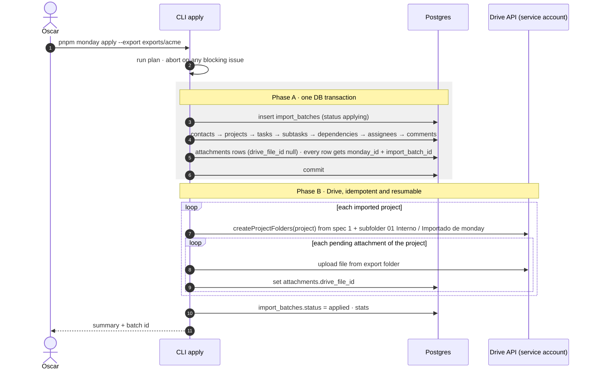
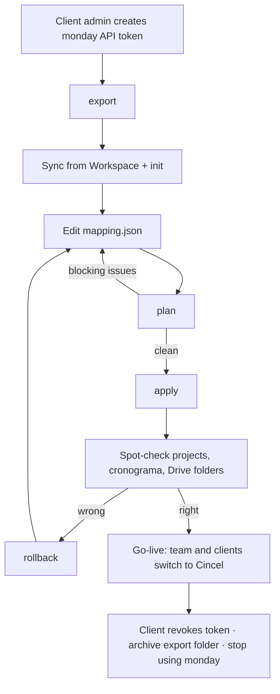

# Cincel Workspace: One-time monday.com migration

**Spec 3 of 3** · Depends on: `cincel-staff-sso-spec.md` (staff rows + **Sync from Workspace**, service account, project Drive folders)
**Build order:** spec 1 → **spec 3** → spec 2 (portal)
**Status:** Ready to implement · **Owner:** Oscar · **Date:** 2026-10-28 · **monday API version:** `2026-07`

---

## 0. Context for the implementer

- Same app: Next.js (App Router) + TypeScript + Drizzle (Postgres). Domain: `contacts` (client | partner | provider), `areas`, `workflows` → task templates, `projects` (require a client), `tasks` (`workflow` | `user`, one workflow task per template per project).
- Staff come from Google Workspace groups (spec 1). Files live in Google Drive: one Shared Drive per area, a folder per project with `01 Interno`, `02 Cliente`, `03 Del cliente`.
- Several of Oscar's clients currently run their work in monday.com. Each one is migrated **once**, at cutover, then stops using monday.

### Decisions already made (don't revisit)
1. **One-time migration per client. No sync, no delta, no webhooks, no OAuth app.**
2. **A CLI inside the Cincel repo, run by Oscar.** No admin UI in v1.
3. **Auth to monday:** a personal API token from a client admin, via env var, revoked after migration.
4. **Export first, import from files.** The export folder is also the client's archive of their monday data.
5. **The mapping is a hand-edited `mapping.json`,** drafted by the tool.
6. **`plan` (dry run) → `apply` (one DB transaction) → `rollback` if wrong.** Every imported row carries `monday_id` + `import_batch_id`. Re-applying never duplicates.
7. **Rollback only before go-live.** Once staff or clients add data to imported rows, fix forward by hand.
8. **Files go to Drive,** into the project's `01 Interno/Importado de monday` folder, uploaded by the service account. Never to `02 Cliente` automatically.
9. **People map to staff by email.** Run spec 1's **Sync from Workspace** first so staff who haven't signed in yet still exist.

### Defaults to confirm (build with these unless told otherwise)

| Topic | Default |
|---|---|
| Comments (monday updates) | Imported |
| Files | Imported to Drive |
| Archived/deleted monday items | Not imported |
| Unmatched assignee | Task unassigned; original name kept in `source_metadata` |
| Comment author not in staff | Comment by the importing admin, prefixed "monday · {original name}:" |
| Timeline columns | Feed task `starts_at`/`ends_at` (so the cronograma shows them) |

---

## 1. Goals and non-goals

### Goals
- Move one client's monday account into Cincel in an afternoon: projects, tasks, subtasks, status, assignees, dates, comments, files.
- Nothing is silently dropped: unmapped columns land in `source_metadata`.
- A wrong import can be fully undone before go-live, including files in Drive.

### Non-goals
- Keeping monday and Cincel in sync; re-imports after go-live.
- Archived/deleted items, automations, dashboards, forms, monday docs.
- Dependency types (the API doesn't expose them; imported as finish-to-start).
- An admin UI (possible later, ~3–4 days on top of the same code).

---

## 2. Architecture

```
scripts/monday/
  cli.ts                 entry: export | init | plan | apply | rollback
  client.ts              GraphQL client (API-Version header, retry on rate limits / errors[])
  export.ts              → exports/<client>/
  init.ts                export → mapping.json (draft)
  mapping.schema.ts      Zod schema for mapping.json
  transform.ts           pure: (export, mapping, cincel lookups) → planned rows
  plan.ts                validation + plan.md
  apply.ts               DB transaction, then Drive phase
  rollback.ts
uses from the app:  db (Drizzle) · syncStaffFromWorkspace() · createProjectFolders() · driveAdmin  (spec 1)
```

Commands:

```bash
MONDAY_TOKEN=… pnpm monday export   --out exports/acme [--boards 123,456] [--no-files] [--no-updates]
pnpm monday init     --export exports/acme
pnpm monday plan     --export exports/acme
pnpm monday apply    --export exports/acme --by oscar@<domain>
pnpm monday rollback --batch <import_batch_id>
```

---

## 3. monday API facts the code depends on

Endpoint `POST https://api.monday.com/v2`, GraphQL, header `API-Version: 2026-07`, `Authorization: <token>`.

| Fact | Consequence |
|---|---|
| Daily call limit: Free/Basic/Standard 1,000 · Pro 10,000 · Enterprise 25,000 (resets 00:00 UTC) | A typical export is a few hundred calls. Export is resumable per board |
| Personal token complexity: 10M/min combined (1M on trial/free); 5M per query | Page size ~200 with subitems inline |
| Rate-limit errors carry `retry_in_seconds`; minute limits send `Retry-After` | Sleep and retry, max 5 attempts |
| **Application errors arrive as HTTP 200 with `errors[]`,** sometimes with partial `data` | Any `errors[]` = failed page → retry; never write a partial page |
| `items_page` (nested in `boards`) then root `next_items_page`; `limit` ≤ 500 | Standard pagination loop |
| **Cursor expires 60 min** after the first request for that board | If a board dies, restart that board |
| `items_page` returns active items only | Archived/deleted are naturally excluded |
| `boards` without `hierarchy_types` returns only classic boards | Always pass `[classic, multi_level]` |
| `workspace_id` is `null` for the Main workspace | Treat as a real workspace |
| Max 10,000 items per board; item names 1–255 chars | `tasks.title` must allow 255 |
| Status labels: stable `id` vs display `index` (reorderable). Definitions in `columns { settings }` (`settings_str` deprecated) | **Map statuses by label `id`** |
| `board_relation`, `dependency`, `mirror`: `text` and `value` are always `null` | Use typed fragments |
| Subitems only via `item.subitems`; their own column set; up to 5 levels on multi-level boards | Export subitem board columns too |
| Asset `public_url` valid **1 hour** | Download during export, never later |
| `updates(limit ≤ 100)` per item, newest first, `body` is HTML | Batch 100 item ids per call; sanitize on import |
| `users`: `enabled`, `is_guest`, `is_pending`, `is_admin`, `photo_thumb` deprecated in 2026-07, removal scheduled 2026-10 | Use `status` and `kind` |
| Token sees only what its user sees | Use an admin's token; export prints visible board count |

---

## 4. Export

### 4.1 Output folder

```
exports/acme/
  manifest.json          account {id, slug, name}, exported_at, api_version, token_user, boards[{id,name,items_count,done}], call_count, errors[]
  users.json             [{id, name, email, status, kind}]
  workspaces.json
  boards/<board_id>/
    board.json           {id, name, workspace_id, columns[{id,title,type,settings}], groups[{id,title,position}], subitem_columns[...]}
    items.ndjson         one item per line, subitems nested, typed column values, asset refs
    updates.ndjson       one update per line, replies nested, asset refs
    .done                written last; re-run skips boards that have it
  files/
    index.json           asset_id → {name, size, sha256, path, item_id | update_id}
    <asset_id>/<original-name>
```

### 4.2 Queries

```graphql
fragment ItemFields on Item {
  id name state created_at updated_at creator_id
  group { id }
  parent_item { id }
  assets { id name file_extension file_size }
  column_values {
    id type text
    ... on StatusValue        { label index is_done }
    ... on PeopleValue        { persons_and_teams { id kind } }
    ... on TimelineValue      { from to visualization_type }
    ... on BoardRelationValue { linked_item_ids display_value }
    ... on DependencyValue    { linked_item_ids }
    ... on MirrorValue        { display_value }
  }
}

query Boards($page: Int!) {
  boards(limit: 100, page: $page, state: active, hierarchy_types: [classic, multi_level]) {
    id name workspace_id items_count
    columns { id title type settings }
    groups { id title position }
  }
}

query FirstPage($board: [ID!], $limit: Int!) {
  boards(ids: $board) {
    items_page(limit: $limit) { cursor items { ...ItemFields subitems { ...ItemFields } } }
  }
}

query NextPage($cursor: String!, $limit: Int!) {
  next_items_page(cursor: $cursor, limit: $limit) {
    cursor items { ...ItemFields subitems { ...ItemFields } }
  }
}

query Updates($ids: [ID!]) {
  items(ids: $ids, limit: 100) {
    id
    updates(limit: 100) {
      id body text_body created_at creator_id
      replies { id body created_at creator_id }
      assets { id name file_extension file_size }
    }
  }
}

query Assets($ids: [ID!]!) { assets(ids: $ids) { id name public_url } }

query Users($page: Int!) { users(limit: 1000, page: $page) { id name email status kind } }
```

- Before shipping, generate types against the 2026-07 schema (`graphql-codegen`) and add `DateValue`, `CheckboxValue`, `NumbersValue` subfields. Only the six typed fragments above were verified in the spike.
- For each board's subitems, also fetch the subitems board's columns (`item.subitems[0].board { columns {…} }` once per board) into `board.json.subitem_columns`.
- Download each asset right after its `public_url` is fetched; store its sha256.

### 4.3 Call estimate (printed before starting)

`ceil(boards/100) + ceil(items/200) + ceil(items/100) [updates] + ceil(assets/50) [files] + ceil(users/1000)`
Example, 40 boards, 24,000 items, 2,000 files: ≈ **400 calls**.

---

## 5. Mapping

### 5.1 `init` (no API calls, reads export + Cincel DB)

- **Calls `syncStaffFromWorkspace()` first** (spec 1 §4.8), so all current staff exist.
- Strategy per board:

| Strategy | Detected when | Becomes |
|---|---|---|
| `board_as_project` | default | board → project · groups → task section · items → tasks · subitems → child tasks |
| `group_as_project` | admin chooses | group → project · items → tasks |
| `item_as_project` | most items have subitems | item → project · subitems → tasks |
| `crm_contacts` | email/phone columns dominate | items → contacts |
| `skip` | — | nothing |

- Column targets by type: `status` → status, `people` → assignees, `timeline` → timeline, `date` → due_at, `long_text`/`text` → description (first one) else metadata, `dependency` → dependencies, `board_relation` → client (if it points at a `crm_contacts` board) else metadata, everything else → metadata.
- Status maps per column: label `is_done` → `done`; `/stuck|bloquead|detenid/i` → `blocked`; `/working|proceso|curso/i` → `in_progress`; rest → `todo`.
- People: monday user email (lowercase) → `staff.email`. Guests (`kind = guest`) → `contact`. No match → `null`.
- Client per project: `board_relation` to a CRM board → `relation_column`; else fuzzy-match board/group name to existing `contacts.name` (trigram ≥ 0.8) → `contact`; else `null`.
- Area per board: fuzzy-match workspace name to `areas.name`; else `null`.
- Workflow templates (only if `areaId` set): item names vs that area's task template names (trigram ≥ 0.85), written to `templateMatches` for review.

### 5.2 Mapping schema

```ts
import { z } from "zod";

export const ColumnTarget = z.enum([
  "title", "description", "status", "assignees", "due_at", "timeline", "tags",
  "dependencies", "attachments", "client", "contact_email", "contact_phone",
  "metadata", "ignore",
]);

export const ClientRef = z.discriminatedUnion("kind", [
  z.object({ kind: z.literal("contact"), contactId: z.string() }),
  z.object({ kind: z.literal("relation_column"), columnId: z.string() }),
  z.object({ kind: z.literal("new"), name: z.string() }),
]);

export const BoardMapping = z.object({
  mondayBoardId: z.string(),
  name: z.string(),
  strategy: z.enum(["board_as_project", "group_as_project", "item_as_project", "crm_contacts", "skip"]),
  contactType: z.enum(["client", "partner", "provider"]).optional(),
  areaId: z.string().nullable().optional(),
  client: ClientRef.nullable().optional(),
  groupClients: z.record(z.string(), ClientRef).optional(),   // group_as_project: groupId → client
  columns: z.record(z.string(), ColumnTarget),
  subitemColumns: z.record(z.string(), ColumnTarget).default({}),
  statusMaps: z.record(z.string(), z.record(z.string(), z.string())), // columnId → { labelId → cincel status }
  subitems: z.enum(["child_tasks", "ignore"]).default("child_tasks"),
  templateMatches: z.record(z.string(), z.string()).default({}),       // monday item id → template id
});

export const Mapping = z.object({
  version: z.literal(1),
  boards: z.array(BoardMapping),
  people: z.record(z.string(), z.union([
    z.object({ action: z.literal("staff"), staffId: z.string() }),
    z.object({ action: z.literal("contact"), contactId: z.string().optional() }),
    z.object({ action: z.literal("ignore") }),
    z.null(),
  ])),
  options: z.object({
    includeUpdates: z.boolean().default(true),
    includeFiles: z.boolean().default(true),
  }),
});
export type Mapping = z.infer<typeof Mapping>;
```

### 5.3 Example

```json
{
  "version": 1,
  "boards": [
    {
      "mondayBoardId": "1234567890",
      "name": "Casa Madrid 22",
      "strategy": "board_as_project",
      "areaId": "a3d9…",
      "client": { "kind": "contact", "contactId": "6f1c…" },
      "columns": { "status": "status", "person": "assignees", "timeline": "timeline", "text0": "description", "numbers3": "metadata" },
      "statusMaps": { "status": { "0": "todo", "1": "done", "2": "blocked", "5": "in_progress" } },
      "subitems": "child_tasks",
      "templateMatches": { "987654321": "tpl_permisos" }
    },
    {
      "mondayBoardId": "2223334444",
      "name": "Clientes",
      "strategy": "crm_contacts",
      "contactType": "client",
      "columns": { "email": "contact_email", "phone": "contact_phone" },
      "statusMaps": {}
    }
  ],
  "people": {
    "48202303": { "action": "staff", "staffId": "9b2e…" },
    "331": { "action": "contact" },
    "777": { "action": "ignore" }
  },
  "options": { "includeUpdates": true, "includeFiles": true }
}
```

---

## 6. Plan (dry run)

Reads export + mapping + Cincel DB; writes nothing except `exports/<client>/plan.md`.

- Per board: contacts / projects / tasks / subtasks / dependencies / comments / files to create, and rows skipped because their `monday_id` already exists.
- Issues:

| Code | Blocks apply | Meaning |
|---|---|---|
| `MAPPING_INVALID` | yes | Zod validation failed (path + message) |
| `CLIENT_UNRESOLVED` | yes | A project would have no client |
| `AREA_UNRESOLVED` | yes | A project would have no area (needed for visibility and its Drive folder) |
| `STATUS_UNMAPPED` | yes | A status label id used by an item has no target |
| `TEMPLATE_COLLISION` | yes | Two items in one project matched the same workflow template |
| `AREA_DRIVE_MISSING` | yes (if files on) | Target area has no `drive_shared_drive_id` |
| `PERSON_UNMATCHED` | no | Assignee left empty; name kept in metadata |
| `RELATION_MISSING` | no | Linked item not in the export |
| `TITLE_TRUNCATED` | no | Name > 255 chars |

Loop: edit `mapping.json` → `plan` until no blocking issues.

---

## 7. Apply



Rules:
- **Skip rows whose `monday_id` exists.** Re-applying the same export is safe.
- Tasks: `kind = workflow` with `template_id` when in `templateMatches`, else `kind = user`. Created by the importing admin; `created_at` = monday `created_at`.
- Subitems → tasks with `parent_task_id`. Values on parent rollup columns are ignored; leaf values come from subitems.
- Timeline → `starts_at`/`ends_at`; `visualization_type = milestone` → `is_milestone`.
- Dependencies → `task_dependencies` type `finish_to_start`.
- Comments: sanitize HTML (allowlist: p, br, b, i, ul, ol, li, a); keep `created_at`; author = mapped staff, else the importing admin with the "monday · {name}:" prefix. Replies become comments in order.
- Unmapped columns → `source_metadata` keyed by monday column **title**: `{ "Presupuesto": "125000", "Etapa (mirror)": "Obra negra" }`.
- **Phase B resumes:** re-running `apply` on a batch in `applying` status continues pending folders and uploads only.
- Files go to `01 Interno/Importado de monday`, keeping one subfolder per original monday group name. Staff move client-relevant files to `02 Cliente` themselves.

---

## 8. Rollback and cutover

```bash
pnpm monday rollback --batch <id>
```
1. **Refuse** if any row not in this batch references a batch row (staff added a comment, a client was invited to an imported project, etc.). Print what blocks it. That's the signal to fix forward.
2. Trash Drive files uploaded by the batch and project folders created by it (trash, not delete; recoverable 30 days).
3. Delete batch rows in reverse order: comments → assignees → dependencies → tasks → projects → contacts.
4. `import_batches.status = rolled_back`.

### Runbook per client



---

## 9. Schema

```ts
// db/schema/import.ts
import { pgTable, pgEnum, uuid, text, jsonb, timestamp, index, uniqueIndex, type AnyPgColumn } from "drizzle-orm/pg-core";
import { sql } from "drizzle-orm";

export const importBatchStatus = pgEnum("import_batch_status", ["applying", "applied", "rolled_back"]);

export const importBatches = pgTable("import_batches", {
  id: uuid("id").primaryKey().defaultRandom(),
  source: text("source").notNull().default("monday"),
  accountId: text("account_id").notNull(),
  accountSlug: text("account_slug"),
  accountName: text("account_name"),
  exportedByEmail: text("exported_by_email"),
  exportedAt: timestamp("exported_at", { withTimezone: true }).notNull(),
  exportPath: text("export_path").notNull(),
  apiVersion: text("api_version").notNull().default("2026-07"),
  mapping: jsonb("mapping").notNull(),                       // exact mapping.json used
  stats: jsonb("stats").notNull().default(sql`'{}'::jsonb`),
  status: importBatchStatus("status").notNull().default("applying"),
  appliedBy: text("applied_by").notNull(),
  appliedAt: timestamp("applied_at", { withTimezone: true }).notNull().defaultNow(),
  rolledBackAt: timestamp("rolled_back_at", { withTimezone: true }),
});

/** Spread into contacts, projects, tasks, task_dependencies, comments, attachments. */
export function mondayImportColumns() {
  return {
    mondayId: text("monday_id"),
    importBatchId: uuid("import_batch_id").references((): AnyPgColumn => importBatches.id, { onDelete: "restrict" }),
    sourceMetadata: jsonb("source_metadata"),
  };
}

/** Spread into the same tables' index callback. */
export function mondayImportIndexes(table: string, t: { mondayId: AnyPgColumn; importBatchId: AnyPgColumn }) {
  return {
    mondayIdUq: uniqueIndex(`${table}_monday_id_uq`).on(t.mondayId).where(sql`${t.mondayId} is not null`),
    importBatchIdx: index(`${table}_import_batch_idx`).on(t.importBatchId).where(sql`${t.importBatchId} is not null`),
  };
}
```

Columns this import needs on core tables (add if missing):

| Table | Columns |
|---|---|
| `tasks` | `parent_task_id`, `starts_at`, `ends_at`, `due_at`, `is_milestone`, `title` ≤ 255 |
| `task_dependencies` | `type` default `finish_to_start` |
| `attachments` | `drive_file_id` (null = pending upload), `name`, `mime_type`, `size_bytes`, `sha256`, `task_id` or `comment_id` |
| `projects` | Drive folder columns from spec 1, plus `drive_import_folder_id` |

monday ids are numeric and unique across accounts, so a plain unique index on `monday_id` holds even with several clients in one database. Confirm on the first two real exports.

---

## 10. Acceptance criteria

1. Export of a test account produces the folder layout in §4.1; killing it mid-way and re-running skips `.done` boards.
2. `init` produces a mapping that passes Zod; `plan` lists every blocking issue with board and item ids.
3. `apply` with a blocking issue refuses and writes nothing.
4. A clean `apply` creates the counts in `plan.md`; every row has `monday_id` and `import_batch_id`.
5. Running `apply` again creates nothing new.
6. Statuses map by label id: reordering labels in monday between two exports doesn't change results.
7. Subitems become child tasks; timeline values show in the project's cronograma.
8. Files appear in `01 Interno/Importado de monday/<group>` of the project's Drive folder, never in `02 Cliente`.
9. Killing `apply` during phase B and re-running finishes uploads without duplicates.
10. `rollback` removes all batch rows and trashes its Drive files and folders; after a staff comment is added to an imported task, `rollback` refuses and names the blocking row.

---

## 11. Implementation order

1. GraphQL client with retry and `errors[]` handling; codegen types.
2. `export` with resumable boards and file downloads.
3. `mapping.schema.ts`, `init` heuristics, call to `syncStaffFromWorkspace()`.
4. `transform` (pure functions, unit-tested with fixture exports) + `plan` + `plan.md`.
5. `apply` phase A (transaction) and phase B (Drive, resumable).
6. `rollback` with reference check and Drive trash.
7. End to end on the first real client before go-live day.

Rough effort: **~7–8 days**, after spec 1's staff sync and project folder creation exist.

---

## 12. Sources

- [Rate limits](https://developer.monday.com/api-reference/docs/rate-limits) · [Errors](https://developer.monday.com/api-reference/docs/errors) · [API versioning](https://developer.monday.com/api-reference/docs/api-versioning)
- [Items page](https://developer.monday.com/api-reference/docs/items_page) · [Next items page](https://developer.monday.com/api-reference/reference/next-items-page) · [Items](https://developer.monday.com/api-reference/reference/items) · [Subitems](https://developer.monday.com/api-reference/reference/subitems) · [Boards](https://developer.monday.com/api-reference/reference/boards) · [Users](https://developer.monday.com/api-reference/reference/users)
- [Column values](https://developer.monday.com/api-reference/docs/column-values-v2) · [Column types reference](https://developer.monday.com/api-reference/docs/column-types-reference) · [Status](https://developer.monday.com/api-reference/reference/status) · [People](https://developer.monday.com/api-reference/reference/people) · [Timeline](https://developer.monday.com/api-reference/reference/timeline) · [Connect boards](https://developer.monday.com/api-reference/reference/connect) · [Dependency](https://developer.monday.com/api-reference/reference/dependency) · [Mirror](https://developer.monday.com/api-reference/reference/mirror)
- [Updates](https://developer.monday.com/api-reference/reference/updates) · [Assets](https://developer.monday.com/api-reference/reference/assets-1)
