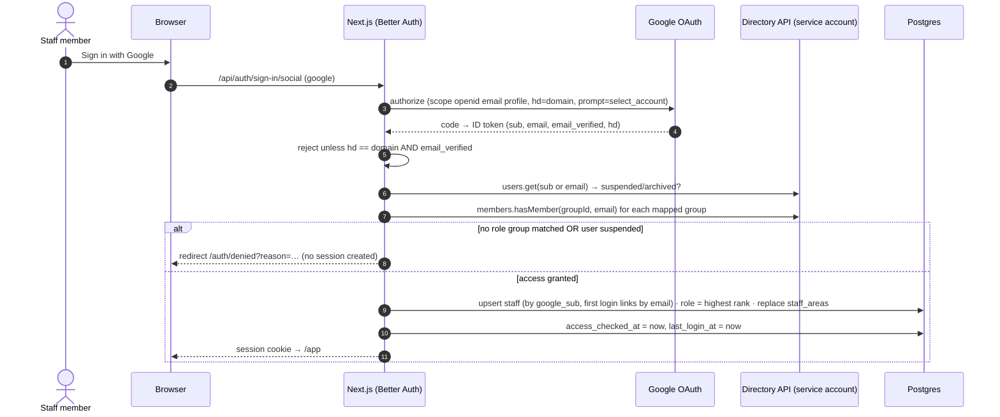
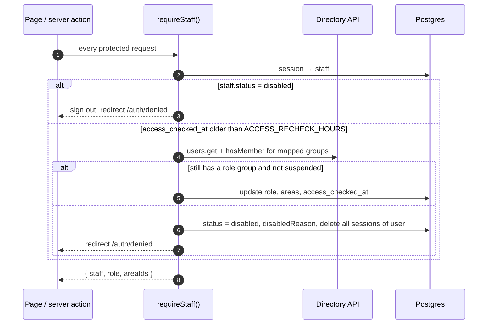
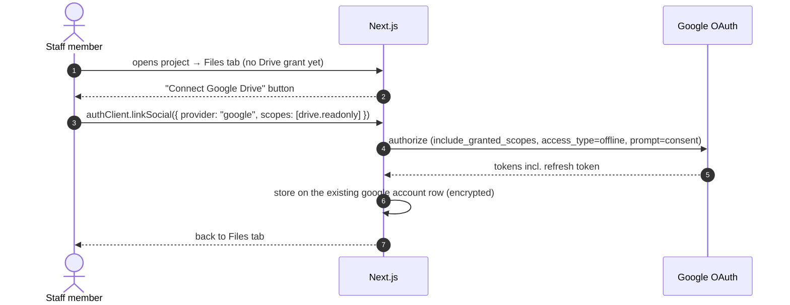
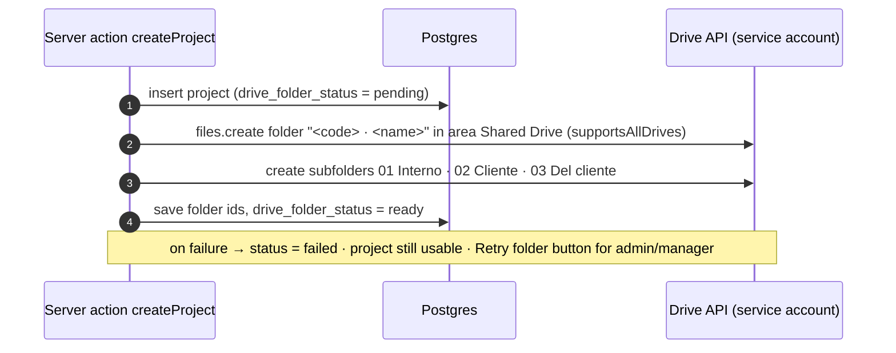

# Cincel Workspace: Staff SSO with Google Workspace

**Spec 1 of 2** · Companion: `cincel-client-portal-spec.md` (depends on this one)
**Status:** Ready to implement · **Owner:** Oscar · **Date:** 2026-10-28

---

## 0. Context for the implementer

- **App:** Cincel Workspace, a greenfield rebuild. Next.js (App Router) + TypeScript + Drizzle ORM (Postgres) + shadcn/ui + Tailwind.
- **Domain model (already designed):**
  - `contacts`: CRM, type `client | partner | provider`
  - `areas`: company areas with members and assigned workflows
  - `workflows`: ordered task templates
  - `projects`: require a client contact
  - `tasks`: `workflow` or `user` kind; every task belongs to a project; one workflow task per template per project
- **The client company** uses Google Workspace on its own domain and works heavily in Google Drive.
- **This spec covers staff only.** External clients log in through the portal (spec 2).

### Decisions already made (don't revisit)
1. **Staff sign in only with Google.** No staff passwords.
2. **Google Workspace groups are the source of truth** for who can access Cincel, their role, and their areas. Cincel never edits roles or areas by hand; it mirrors the groups.
3. **Staff rows are created and updated automatically at sign-in** from group membership. They still exist because tasks and projects reference staff.
4. **Drive enforces staff file access.** Staff Drive calls use the staff member's own Google token. Cincel stores file and folder IDs, never copies or its own file ACLs.
5. **Drive scopes are not requested at login.** They are requested the first time a user opens a Drive feature (incremental authorization).
6. **One Shared Drive per area.** The area's Google group is a member. Project folders live inside it.
7. **Auth library: Better Auth** with the Drizzle adapter.

### Defaults to confirm with the client (build with these unless told otherwise)

| Topic | Default |
|---|---|
| Roles | `admin`, `manager`, `staff`, `viewer` |
| Project visibility | `admin`: all projects · `manager`, `staff`, `viewer`: all projects in their areas |
| Who can create/edit | `admin`, `manager`: everything in their scope · `staff`: tasks, comments · `viewer`: read-only |
| Access re-check interval | every 4 hours |
| Drive layout | one Shared Drive per area; one folder per project, created by Cincel |

---

## 1. Goals and non-goals

### Goals
- A staff member clicks **Sign in with Google**, picks their company account, and lands in Cincel with the right role and areas, with no account setup by anyone in Cincel.
- Anyone not in a Cincel group (or outside the domain) is refused with a clear message.
- Removing someone from a group or suspending their Workspace account removes their Cincel access within the re-check interval, with no action in Cincel.
- Projects get a Drive folder automatically. Staff see the folder's files inside Cincel, filtered by what Drive lets them see.

### Non-goals (v1)
- External clients (spec 2).
- Editing files in Cincel. Staff open files in Drive.
- Uploading to Drive from Cincel's staff UI. Staff upload in Drive directly.
- Per-project assignment-based visibility (only area-based).
- Real-time group change push. Polling at re-check is enough.

---

## 2. Architecture

```
Browser ──► Next.js (App Router)
             ├── /api/auth/*            Better Auth (Google provider, hd = company domain)
             ├── server: requireStaff()  session + periodic Workspace access re-check
             ├── server: workspaceDirectory   Admin SDK Directory API   (service account)
             ├── server: driveAdmin           Drive API, create folders (service account)
             └── server: driveUser            Drive API, list/read      (user's own token)
          Postgres (Drizzle)
             Better Auth tables · staff · staff_areas · workspace_group_mappings · areas · projects
Google
   OAuth client "Cincel Staff" (Internal)
   Service account "cincel-directory" (custom read-only admin role; member of area Shared Drives)
```

### Two kinds of Google credentials

| Credential | Used for | Scopes |
|---|---|---|
| **User OAuth token** (per staff member) | Sign-in; listing Drive files the user can see | Login: `openid email profile`. Drive feature: + `drive.readonly` (incremental) |
| **Service account** (one, server only) | Group membership and user status checks; creating project folders | `admin.directory.group.member.readonly`, `admin.directory.user.readonly`, `drive` |

The service account calls the Directory API **as itself**, using a custom admin role assigned to it in the Admin console. **No domain-wide delegation.**

---

## 3. Data model

Better Auth generates its core tables (`user`, `session`, `account`, `verification`) via its CLI. Generate them into the Drizzle schema; don't hand-write them. The Google `sub` is stored by Better Auth as `account.accountId` for `providerId = "google"`.

```ts
// db/schema/staff.ts
import { pgTable, pgEnum, uuid, text, integer, timestamp, primaryKey, uniqueIndex } from "drizzle-orm/pg-core";
import { user } from "./auth";   // Better Auth generated
import { areas } from "./areas";

export const staffRole = pgEnum("staff_role", ["admin", "manager", "staff", "viewer"]);
export const staffStatus = pgEnum("staff_status", ["active", "disabled"]);

export const staff = pgTable("staff", {
  id: uuid("id").primaryKey().defaultRandom(),
  userId: text("user_id").notNull().unique().references(() => user.id, { onDelete: "cascade" }),
  email: text("email").notNull().unique(),            // lowercase
  name: text("name").notNull(),
  googleSub: text("google_sub").notNull().unique(),   // stable Google id; never match on email after first sign-in
  role: staffRole("role").notNull(),
  status: staffStatus("status").notNull().default("active"),
  accessCheckedAt: timestamp("access_checked_at", { withTimezone: true }).notNull(),
  lastLoginAt: timestamp("last_login_at", { withTimezone: true }),
  disabledReason: text("disabled_reason"),            // "no_cincel_group" | "workspace_suspended" | ...
  createdAt: timestamp("created_at", { withTimezone: true }).notNull().defaultNow(),
});

export const staffAreas = pgTable("staff_areas", {
  staffId: uuid("staff_id").notNull().references(() => staff.id, { onDelete: "cascade" }),
  areaId: uuid("area_id").notNull().references(() => areas.id, { onDelete: "cascade" }),
}, (t) => ({ pk: primaryKey({ columns: [t.staffId, t.areaId] }) }));

export const groupMappingKind = pgEnum("group_mapping_kind", ["role", "area"]);

// Admin-configured: which Workspace groups mean what in Cincel
export const workspaceGroupMappings = pgTable("workspace_group_mappings", {
  id: uuid("id").primaryKey().defaultRandom(),
  groupEmail: text("group_email").notNull(),          // shown in UI
  groupId: text("group_id").notNull(),                // resolved once via groups.get; survives renames
  kind: groupMappingKind("kind").notNull(),
  role: staffRole("role"),                            // when kind = role
  areaId: uuid("area_id").references(() => areas.id), // when kind = area
  rank: integer("rank").notNull().default(0),         // higher wins when several role groups match
}, (t) => ({ groupUq: uniqueIndex("workspace_group_mappings_group_uq").on(t.groupId) }));
```

Additions to existing tables:

```ts
// areas
driveSharedDriveId: text("drive_shared_drive_id"),     // the area's Shared Drive
workspaceGroupEmail: text("workspace_group_email"),    // convenience; source of truth is workspace_group_mappings

// projects
driveFolderId: text("drive_folder_id"),
driveInternalFolderId: text("drive_internal_folder_id"),   // "01 Interno"
driveClientFolderId: text("drive_client_folder_id"),       // "02 Cliente"   (spec 2)
driveInboundFolderId: text("drive_inbound_folder_id"),     // "03 Del cliente" (spec 2)
driveFolderStatus: text("drive_folder_status").notNull().default("pending"), // pending | ready | failed
```

Seed `workspace_group_mappings` with the default convention:

| Group | Kind | Value | Rank |
|---|---|---|---|
| `cincel-admins@<domain>` | role | admin | 40 |
| `cincel-managers@<domain>` | role | manager | 30 |
| `cincel-staff@<domain>` | role | staff | 20 |
| `cincel-viewers@<domain>` | role | viewer | 10 |
| `cincel-area-<slug>@<domain>` | area | `<area id>` | – |

---

## 4. Flows

### 4.1 First and subsequent sign-in



Rules:
- **Gate before the session exists.** Do the Directory checks in a Better Auth hook that runs before session creation (e.g. `databaseHooks.session.create.before` or a `hooks.before` on the callback). Throwing there must abort sign-in. Verify the exact hook against the Better Auth docs for the installed version.
- **Configure `hd` on the Google provider.** Better Auth then rejects tokens without the matching `hd` claim. Also assert `email_verified === true`.
- **Match on `sub`, not email.** On first sign-in, link an existing `staff` row by lowercase email only if it has no `google_sub` yet; afterwards always by `sub`.
- **Areas are replaced, not merged,** on every check.
- **A user with a role group but no area group** may sign in. `admin` sees everything; others see an empty state "You're not in any area yet — ask your Workspace admin".
- **Directory API failure** (5xx, timeout): at sign-in, deny with "try again". At re-check (4.2), keep the current access and retry next request; don't lock everyone out because Google hiccupped. Log it.

### 4.2 Periodic access re-check



- `requireStaff()` is the **only** way server code gets the current user. Use it in layouts, server components, route handlers and server actions. Don't put it in `middleware.ts` (edge runtime, no DB/Google); middleware only redirects requests without a session cookie to `/login`.
- Use a per-user lock (Postgres advisory lock on staff id, or an in-process single-flight) so parallel requests don't all hit the Directory API.
- A disabled staff member who is later re-added to a group is re-enabled at their next sign-in (4.1 re-runs the checks).

### 4.3 Authorization helpers

```ts
type StaffCtx = { staffId: string; role: "admin" | "manager" | "staff" | "viewer"; areaIds: string[] };

canViewProject(ctx, project)  // admin || ctx.areaIds.includes(project.areaId)
canEditProject(ctx, project)  // canViewProject && role in (admin, manager)
canEditTask(ctx, task)        // canViewProject(task.project) && role !== "viewer"
projectScope(ctx)             // Drizzle where-clause: admin → none; else project.area_id in ctx.areaIds
```

- Every list query goes through `projectScope(ctx)`. Every mutation checks the matching `can*` helper server-side. UI hiding is cosmetic only.
- Unit-test these helpers per role.

### 4.4 Connect Drive (incremental consent)



- Request `https://www.googleapis.com/auth/drive.readonly`. It's a restricted scope, but the OAuth client is **Internal**, so Google doesn't review it. Confirm in the Cloud console that the app shows no verification requirement.
- Store refresh tokens **encrypted at rest:** set Better Auth `account.encryptOAuthTokens: true` (default is `false`).
- If Google returns `invalid_grant` (revoked, password reset), clear the Drive tokens and show "Connect Google Drive" again.

### 4.5 Project folder creation



- Run after the project row commits. A Drive failure must never roll back the project.
- Idempotent retry: if `drive_folder_id` is set, only create missing subfolders.
- Renaming a project renames the Drive folder (best effort; log on failure).
- Archiving a project doesn't touch Drive.
- Inside a Shared Drive, members of the area group inherit access, so no per-folder sharing is needed for staff.

### 4.6 Files tab (staff)

- Server route `GET /api/projects/[id]/files?folder=<id>`:
  1. `requireStaff()` + `canViewProject`.
  2. Use **the user's token** to call `files.list` with `q = '<folderId>' in parents and trashed = false`, `supportsAllDrives`, `includeItemsFromAllDrives`, fields `id,name,mimeType,modifiedTime,size,iconLink,webViewLink`.
  3. `folder` must be the project folder or a descendant. Check the parents chain with the service account, with a short cache.
- The UI shows the three subfolders, breadcrumbs, and an **Open in Drive** link per file (`webViewLink`). There's no download proxy for staff.
- If Drive returns 403/404 for the user, show "You don't have access to this folder in Drive". Drive is the authority.

### 4.7 Offboarding (no Cincel action needed)

| Event in Workspace | Effect in Cincel |
|---|---|
| User removed from all `cincel-*` role groups | Disabled at next re-check (≤ 4 h); sessions deleted |
| User suspended or deleted | Disabled at next re-check; can't sign in again |
| User moved between area groups | Areas updated at next re-check |
| Need it immediate | Admin clicks **Re-check now** on the staff page (runs 4.2 for that user) |

Tasks and projects keep referencing the disabled staff row. Never delete staff.

---

## 5. Admin UI (Cincel)

All read-only except where noted. Admins only.

- **Staff list:** name, email, role, areas, status, last login, access checked at. Actions: **Re-check now**. Banner: "Roles and areas are managed in Google Workspace groups."
- **Group mappings:** list and add/edit/delete (editable). Adding a mapping resolves the group with `groups.get` and stores `groupId`; it fails if the group doesn't exist.
- **Areas:** shows the Shared Drive link and group per area.
- **Health panel:** last Directory API error, last Drive API error, service account email.

---

## 6. Configuration

```
BETTER_AUTH_URL=https://app.<domain>
BETTER_AUTH_SECRET=…
GOOGLE_STAFF_CLIENT_ID=…
GOOGLE_STAFF_CLIENT_SECRET=…
GOOGLE_WORKSPACE_DOMAIN=<domain>
GOOGLE_WORKSPACE_CUSTOMER_ID=…            # optional, for groups.get
GOOGLE_SA_CREDENTIALS=<base64 JSON key>   # or a file path; never committed
ACCESS_RECHECK_HOURS=4
```

Better Auth Google provider (sketch; verify option names against the installed version):

```ts
socialProviders: {
  google: {
    clientId: process.env.GOOGLE_STAFF_CLIENT_ID!,
    clientSecret: process.env.GOOGLE_STAFF_CLIENT_SECRET!,
    hd: process.env.GOOGLE_WORKSPACE_DOMAIN,  // rejects other domains
    prompt: "select_account",
  },
},
account: { encryptOAuthTokens: true },
session: { expiresIn: 60 * 60 * 24 * 7, updateAge: 60 * 60 * 24 },
```

Directory client: `google-auth-library` `JWT` / `GoogleAuth` with the service account key and scopes `admin.directory.group.member.readonly`, `admin.directory.user.readonly`. **No `subject`** (no impersonation).

---

## 7. Workspace admin checklist (client side, one time)

1. **Google Cloud project** "Cincel" in the client's organization. Enable **Admin SDK API** and **Google Drive API**.
2. **OAuth consent screen:** user type **Internal**; app name, support email, logo.
3. **OAuth client:** type *Web application*. Redirect URIs: `https://app.<domain>/api/auth/callback/google` (+ staging/local).
4. **Service account** `cincel-directory`. Create a JSON key and send it securely, or use workload identity if hosting supports it.
5. **Custom admin role** "Cincel directory reader" in Admin console → Account → Admin roles, with read privileges for **Groups** and **Users**. Assign it to the service account's email.
6. **Groups:** `cincel-admins`, `cincel-managers`, `cincel-staff`, `cincel-viewers`, and one `cincel-area-<slug>` per area. Add people.
7. **Shared Drives:** one per area. Members: that area's group (Content manager or Contributor, client's choice) and the service account (Content manager).
8. Send Cincel: domain, OAuth client id/secret, service account key, group emails, Shared Drive IDs.

---

## 8. Security requirements

- Validate `hd` and `email_verified` on every sign-in; identify users by `sub`.
- No session before the access gate passes.
- Service account key only in secrets storage; least-privilege custom role (read only).
- Refresh tokens encrypted at rest; never sent to the browser.
- All authorization server-side through `requireStaff()` + `can*` helpers + `projectScope()`.
- Log sign-in allow/deny with reason, re-check outcomes, and folder creation failures. Never log tokens.
- Session cookie: `httpOnly`, `secure`, `sameSite=lax`; session lifetime 7 days, sliding. The 4 h re-check bounds staleness, not the session length.

---

## 9. Acceptance criteria

1. A domain user in `cincel-staff` + `cincel-area-obra` signs in, gets role `staff`, sees only Obra projects.
2. A domain user in no Cincel group is refused at `/auth/denied` with "not enabled for Cincel"; no `session` row is created.
3. A personal Gmail account cannot complete sign-in (blocked by Internal consent and the `hd` check).
4. In both `cincel-managers` and `cincel-staff` → role `manager`.
5. Removed from `cincel-staff` while signed in → next request after the re-check interval signs them out. **Re-check now** does it immediately.
6. Suspended in Workspace → same as 5.
7. A Directory API outage during re-check doesn't sign anyone out; during sign-in it shows a retry message.
8. Creating a project creates its folder and three subfolders in the right Shared Drive. A Drive failure leaves the project usable with **Retry folder**.
9. The Files tab asks for Drive once, then lists folder contents with the user's own token; a user without Drive access to that Shared Drive sees the "no access in Drive" state.
10. `viewer` cannot create or edit anything (server actions return 403 even when called directly).

---

## 10. Implementation order

1. Better Auth + Google provider (`hd`), generated auth tables, `/login`, `/auth/denied`.
2. `staff`, `staff_areas`, `workspace_group_mappings` + seed; Directory client; sign-in gate (4.1).
3. `requireStaff()` with re-check (4.2) and lock; authorization helpers + tests (4.3).
4. Admin pages: staff list, group mappings, re-check now.
5. Drive: service-account client; project folder creation + retry (4.5).
6. Drive: incremental consent + token encryption (4.4); Files tab (4.6).
7. Acceptance pass (§9) against a test Workspace or the client's staging groups.

Rough effort: **3–4 days.**

---

## 11. Sources

- [Better Auth: Google provider](https://better-auth.com/docs/authentication/google) (`hd`, `prompt`, `accessType`, `linkSocial` for extra scopes)
- [Admin SDK: members.hasMember](https://developers.google.com/workspace/admin/directory/reference/rest/v1/members/hasMember) (follows nested groups within the same domain)
- [Use service accounts with Google Groups APIs without domain-wide delegation](https://workspaceupdates.googleblog.com/2020/08/use-service-accounts-google-groups-without-domain-wide-delegation.html)
- [Assign specific admin roles](https://support.google.com/a/answer/9807615)
- [Choose Google Drive API scopes](https://developers.google.com/workspace/drive/api/guides/api-specific-auth)
